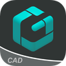

<div align="center">

<picture><source media="(prefers-color-scheme: dark)" srcset="https://raw.githubusercontent.com/hxreborn/morphe-patches/assets/banner-dark.svg"></picture>

[](https://github.com/hxreborn/morphe-patches/releases/latest)
[](https://github.com/hxreborn/morphe-patches/stargazers)
[](https://ko-fi.com/hxreborn)

<a href="https://morphe.software/add-source?github=hxreborn/morphe-patches" title="Add this source to Morphe">
  
</a>

AMOLED themes, ad and tracking removal and settings tweaks for 100+ Android apps.

</div>

##  Patches list

<!-- PATCHES_START -->
> **[v1.63.0](https://github.com/hxreborn/morphe-patches/releases/tag/v1.63.0)**&nbsp;&nbsp;•&nbsp;&nbsp;`main`&nbsp;&nbsp;•&nbsp;&nbsp;348 patches total

<table>
<tr>
<td align="center" width="25%"><a href="#1weather"><br>1Weather</a><br><sub>4 patches</sub></td>
<td align="center" width="25%"><a href="#3way"><br>3way</a><br><sub>1 patch</sub></td>
<td align="center" width="25%"><a href="#acalendar"><br>aCalendar</a><br><sub>1 patch</sub></td>
<td align="center" width="25%"><a href="#albo"><br>Albo</a><br><sub>4 patches</sub></td>
</tr>
<tr>
<td align="center" width="25%"><a href="#all-video-player-app"><br>All Video Player App</a><br><sub>6 patches</sub></td>
<td align="center" width="25%"><a href="#all-in-one-calculator"><br>All-In-One Calculator</a><br><sub>2 patches</sub></td>
<td align="center" width="25%"><a href="#aloa"><br>Aloa</a><br><sub>2 patches</sub></td>
<td align="center" width="25%"><a href="#alpinequest"><br>AlpineQuest</a><br><sub>1 patch</sub></td>
</tr>
<tr>
<td align="center" width="25%"><a href="#anytracker"><br>AnyTracker</a><br><sub>1 patch</sub></td>
<td align="center" width="25%"><a href="#arc-player"><br>Arc Player</a><br><sub>3 patches</sub></td>
<td align="center" width="25%"><a href="#athan"><br>Athan</a><br><sub>6 patches</sub></td>
<td align="center" width="25%"><a href="#atlomaps"><br>AtloMaps</a><br><sub>1 patch</sub></td>
</tr>
<tr>
<td align="center" width="25%"><a href="#atvtools"><br>atvTools</a><br><sub>1 patch</sub></td>
<td align="center" width="25%"><a href="#audible"><br>Audible</a><br><sub>2 patches</sub></td>
<td align="center" width="25%"><a href="#audiobook-unlimited-for-kindle"><br>Audiobook Unlimited for Kindle</a><br><sub>1 patch</sub></td>
<td align="center" width="25%"><a href="#audiolab"><br>AudioLab</a><br><sub>1 patch</sub></td>
</tr>
<tr>
<td align="center" width="25%"><a href="#automatag"><br>AutomaTag</a><br><sub>1 patch</sub></td>
<td align="center" width="25%"><a href="#bangla-calendar"><br>Bangla Calendar</a><br><sub>2 patches</sub></td>
<td align="center" width="25%"><a href="#bettersleep"><br>BetterSleep</a><br><sub>1 patch</sub></td>
<td align="center" width="25%"><a href="#biobird-flashcards"><br>Biobird Flashcards</a><br><sub>2 patches</sub></td>
</tr>
<tr>
<td align="center" width="25%"><a href="#blockit"><br>blockit</a><br><sub>2 patches</sub></td>
<td align="center" width="25%"><a href="#blurwall"><br>BlurWall</a><br><sub>3 patches</sub></td>
<td align="center" width="25%"><a href="#botim"><br>botim</a><br><sub>3 patches</sub></td>
<td align="center" width="25%"><a href="#calcnote"><br>CalcNote</a><br><sub>1 patch</sub></td>
</tr>
<tr>
<td align="center" width="25%"><a href="#cast-plug-in-for-musicolet"><br>Cast Plug-in for Musicolet</a><br><sub>1 patch</sub></td>
<td align="center" width="25%"><a href="#castle"><br>Castle</a><br><sub>4 patches</sub></td>
<td align="center" width="25%"><a href="#castle-for-tv"><br>Castle for TV</a><br><sub>3 patches</sub></td>
<td align="center" width="25%"><a href="#catzy"><br>Catzy</a><br><sub>4 patches</sub></td>
</tr>
<tr>
<td align="center" width="25%"><a href="#clink"><br>Clink</a><br><sub>1 patch</sub></td>
<td align="center" width="25%"><a href="#clip-studio-paint"><br>Clip Studio Paint</a><br><sub>1 patch</sub></td>
<td align="center" width="25%"><a href="#clone-app"><br>Clone App</a><br><sub>4 patches</sub></td>
<td align="center" width="25%"><a href="#coddy"><br>Coddy</a><br><sub>1 patch</sub></td>
</tr>
<tr>
<td align="center" width="25%"><a href="#cubasis-le-3"><br>Cubasis LE 3</a><br><sub>2 patches</sub></td>
<td align="center" width="25%"><a href="#cx-file-explorer"><br>Cx File Explorer</a><br><sub>3 patches</sub></td>
<td align="center" width="25%"><a href="#cxxdroid"><br>Cxxdroid</a><br><sub>3 patches</sub></td>
<td align="center" width="25%"><a href="#depthpix"><br>DepthPix</a><br><sub>3 patches</sub></td>
</tr>
<tr>
<td align="center" width="25%"><a href="#desh-telugu-keyboard"><br>Desh Telugu Keyboard</a><br><sub>2 patches</sub></td>
<td align="center" width="25%"><a href="#devcheck"><br>DevCheck</a><br><sub>2 patches</sub></td>
<td align="center" width="25%"><a href="#dwg-fastview"><br>DWG FastView</a><br><sub>3 patches</sub></td>
<td align="center" width="25%"><a href="#echo-equalizer"><br>Echo Equalizer</a><br><sub>1 patch</sub></td>
</tr>
<tr>
<td align="center" width="25%"><a href="#echogram"><br>Echogram</a><br><sub>1 patch</sub></td>
<td align="center" width="25%"><a href="#etsy"><br>Etsy</a><br><sub>1 patch</sub></td>
<td align="center" width="25%"><a href="#fast-stl-viewer"><br>Fast STL Viewer</a><br><sub>1 patch</sub></td>
<td align="center" width="25%"><a href="#fddb"><br>Fddb</a><br><sub>1 patch</sub></td>
</tr>
<tr>
<td align="center" width="25%"><a href="#focusnow"><br>FocusNow</a><br><sub>3 patches</sub></td>
<td align="center" width="25%"><a href="#forusapp"><br>ForusApp</a><br><sub>1 patch</sub></td>
<td align="center" width="25%"><a href="#glass-widgets"><br>Glass Widgets</a><br><sub>1 patch</sub></td>
<td align="center" width="25%"><a href="#graph-messenger"><br>Graph Messenger</a><br><sub>4 patches</sub></td>
</tr>
<tr>
<td align="center" width="25%"><a href="#hindu-calendar"><br>Hindu Calendar</a><br><sub>2 patches</sub></td>
<td align="center" width="25%"><a href="#imo"><br>imo</a><br><sub>17 patches</sub></td>
<td align="center" width="25%"><a href="#internet-speed-meter-lite"><br>Internet Speed Meter Lite</a><br><sub>3 patches</sub></td>
<td align="center" width="25%"><a href="#iototoy"><br>IoToToy</a><br><sub>2 patches</sub></td>
</tr>
<tr>
<td align="center" width="25%"><a href="#joyn"><br>Joyn</a><br><sub>1 patch</sub></td>
<td align="center" width="25%"><a href="#joyn-austria"><br>Joyn Austria</a><br><sub>1 patch</sub></td>
<td align="center" width="25%"><a href="#jujo"><br>Jujo</a><br><sub>2 patches</sub></td>
<td align="center" width="25%"><a href="#jvdroid"><br>Jvdroid</a><br><sub>3 patches</sub></td>
</tr>
<tr>
<td align="center" width="25%"><a href="#keepa"><br>Keepa</a><br><sub>4 patches</sub></td>
<td align="center" width="25%"><a href="#kick"><br>Kick</a><br><sub>1 patch</sub></td>
<td align="center" width="25%"><a href="#klassik-radio"><br>Klassik Radio+</a><br><sub>1 patch</sub></td>
<td align="center" width="25%"><a href="#lagguy-wallpapers"><br>Lagguy Wallpapers</a><br><sub>2 patches</sub></td>
</tr>
<tr>
<td align="center" width="25%"><a href="#led-blinker"><br>LED Blinker</a><br><sub>1 patch</sub></td>
<td align="center" width="25%"><a href="#lingodeer"><br>LingoDeer</a><br><sub>3 patches</sub></td>
<td align="center" width="25%"><a href="#magic-earth"><br>Magic Earth</a><br><sub>1 patch</sub></td>
<td align="center" width="25%"><a href="#may-beautiful-bullet-journal"><br>May: Beautiful Bullet Journal</a><br><sub>1 patch</sub></td>
</tr>
<tr>
<td align="center" width="25%"><a href="#medicneet"><br>MedicNEET</a><br><sub>2 patches</sub></td>
<td align="center" width="25%"><a href="#memoneet"><br>MemoNeet</a><br><sub>2 patches</sub></td>
<td align="center" width="25%"><a href="#minishare"><br>MiniShare</a><br><sub>1 patch</sub></td>
<td align="center" width="25%"><a href="#monet-launcher"><br>Monet Launcher</a><br><sub>1 patch</sub></td>
</tr>
<tr>
<td align="center" width="25%"><a href="#moon-reader"><br>Moon+ Reader</a><br><sub>3 patches</sub></td>
<td align="center" width="25%"><a href="#moviebox"><br>MovieBox</a><br><sub>4 patches</sub></td>
<td align="center" width="25%"><a href="#moviebox-tv"><br>MovieBox TV</a><br><sub>1 patch</sub></td>
<td align="center" width="25%"><a href="#musicolet"><br>Musicolet</a><br><sub>1 patch</sub></td>
</tr>
<tr>
<td align="center" width="25%"><a href="#musixmatch"><br>Musixmatch</a><br><sub>1 patch</sub></td>
<td align="center" width="25%"><a href="#my-apk"><br>My APK</a><br><sub>1 patch</sub></td>
<td align="center" width="25%"><a href="#mymoveset"><br>MyMoveset</a><br><sub>2 patches</sub></td>
<td align="center" width="25%"><a href="#myscript-math"><br>MyScript Math</a><br><sub>2 patches</sub></td>
</tr>
<tr>
<td align="center" width="25%"><a href="#myscript-notes"><br>MyScript Notes</a><br><sub>2 patches</sub></td>
<td align="center" width="25%"><a href="#nara-baby"><br>Nara Baby</a><br><sub>3 patches</sub></td>
<td align="center" width="25%"><a href="#neetprep"><br>NEETprep</a><br><sub>2 patches</sub></td>
<td align="center" width="25%"><a href="#neetprep-essential"><br>NEETprep Essential</a><br><sub>1 patch</sub></td>
</tr>
<tr>
<td align="center" width="25%"><a href="#network-analyzer"><br>Network Analyzer</a><br><sub>18 patches</sub></td>
<td align="center" width="25%"><a href="#notein"><br>Notein</a><br><sub>1 patch</sub></td>
<td align="center" width="25%"><a href="#notesnook"><br>Notesnook</a><br><sub>2 patches</sub></td>
<td align="center" width="25%"><a href="#one4home-launcher"><br>One4Home Launcher</a><br><sub>1 patch</sub></td>
</tr>
<tr>
<td align="center" width="25%"><a href="#opal"><br>Opal</a><br><sub>2 patches</sub></td>
<td align="center" width="25%"><a href="#period-tracker-and-calendar"><br>Period Tracker and Calendar</a><br><sub>1 patch</sub></td>
<td align="center" width="25%"><a href="#perplexity"><br>Perplexity</a><br><sub>4 patches</sub></td>
<td align="center" width="25%"><a href="#photo-editor-pro"><br>Photo Editor Pro</a><br><sub>6 patches</sub></td>
</tr>
<tr>
<td align="center" width="25%"><a href="#photone"><br>Photone</a><br><sub>1 patch</sub></td>
<td align="center" width="25%"><a href="#pleco"><br>Pleco</a><br><sub>2 patches</sub></td>
<td align="center" width="25%"><a href="#pocket-whip"><br>Pocket Whip</a><br><sub>2 patches</sub></td>
<td align="center" width="25%"><a href="#poe"><br>Poe</a><br><sub>2 patches</sub></td>
</tr>
<tr>
<td align="center" width="25%"><a href="#prayer-times-and-qibla"><br>Prayer Times and Qibla</a><br><sub>1 patch</sub></td>
<td align="center" width="25%"><a href="#privacy-notes"><br>Privacy Notes</a><br><sub>1 patch</sub></td>
<td align="center" width="25%"><a href="#projectivy-launcher"><br>Projectivy Launcher</a><br><sub>1 patch</sub></td>
<td align="center" width="25%"><a href="#proton-authenticator"><br>Proton Authenticator</a><br><sub>5 patches</sub></td>
</tr>
<tr>
<td align="center" width="25%"><a href="#proton-lumo"><br>Proton Lumo</a><br><sub>4 patches</sub></td>
<td align="center" width="25%"><a href="#proton-mail"><br>Proton Mail</a><br><sub>11 patches</sub></td>
<td align="center" width="25%"><a href="#proton-pass"><br>Proton Pass</a><br><sub>8 patches</sub></td>
<td align="center" width="25%"><a href="#proton-vpn"><br>Proton VPN</a><br><sub>13 patches</sub></td>
</tr>
<tr>
<td align="center" width="25%"><a href="#psiphon"><br>Psiphon</a><br><sub>1 patch</sub></td>
<td align="center" width="25%"><a href="#public"><br>Public</a><br><sub>3 patches</sub></td>
<td align="center" width="25%"><a href="#pydroid-3"><br>Pydroid 3</a><br><sub>3 patches</sub></td>
<td align="center" width="25%"><a href="#qr-barcode-scanner"><br>QR & Barcode Scanner</a><br><sub>1 patch</sub></td>
</tr>
<tr>
<td align="center" width="25%"><a href="#quick-cursor"><br>Quick Cursor</a><br><sub>1 patch</sub></td>
<td align="center" width="25%"><a href="#quranify"><br>Quranify</a><br><sub>1 patch</sub></td>
<td align="center" width="25%"><a href="#radio-javan"><br>Radio Javan</a><br><sub>3 patches</sub></td>
<td align="center" width="25%"><a href="#raindrop-io"><br>Raindrop.io</a><br><sub>6 patches</sub></td>
</tr>
<tr>
<td align="center" width="25%"><a href="#rateglance"><br>RateGlance</a><br><sub>1 patch</sub></td>
<td align="center" width="25%"><a href="#readera"><br>ReadEra</a><br><sub>13 patches</sub></td>
<td align="center" width="25%"><a href="#realme-link"><br>Realme Link</a><br><sub>2 patches</sub></td>
<td align="center" width="25%"><a href="#ringtone-maker"><br>Ringtone Maker</a><br><sub>2 patches</sub></td>
</tr>
<tr>
<td align="center" width="25%"><a href="#rise-sleep-tracker"><br>RISE Sleep Tracker</a><br><sub>3 patches</sub></td>
<td align="center" width="25%"><a href="#rubber-bands"><br>Rubber Bands</a><br><sub>1 patch</sub></td>
<td align="center" width="25%"><a href="#serializd"><br>Serializd</a><br><sub>3 patches</sub></td>
<td align="center" width="25%"><a href="#sheytoon"><br>Sheytoon</a><br><sub>1 patch</sub></td>
</tr>
<tr>
<td align="center" width="25%"><a href="#showly"><br>Showly</a><br><sub>2 patches</sub></td>
<td align="center" width="25%"><a href="#sqcom"><br>SQCOM</a><br><sub>2 patches</sub></td>
<td align="center" width="25%"><a href="#steezy"><br>STEEZY</a><br><sub>4 patches</sub></td>
<td align="center" width="25%"><a href="#storywise"><br>Storywise</a><br><sub>3 patches</sub></td>
</tr>
<tr>
<td align="center" width="25%"><a href="#sygic"><br>Sygic</a><br><sub>2 patches</sub></td>
<td align="center" width="25%"><a href="#symfonium"><br>Symfonium</a><br><sub>1 patch</sub></td>
<td align="center" width="25%"><a href="#terabox"><br>TeraBox</a><br><sub>7 patches</sub></td>
<td align="center" width="25%"><a href="#trainline"><br>Trainline</a><br><sub>1 patch</sub></td>
</tr>
<tr>
<td align="center" width="25%"><a href="#u-dictionary"><br>U Dictionary</a><br><sub>1 patch</sub></td>
<td align="center" width="25%"><a href="#uptcl"><br>UPTCL</a><br><sub>5 patches</sub></td>
<td align="center" width="25%"><a href="#usa-vpn"><br>USA VPN</a><br><sub>1 patch</sub></td>
<td align="center" width="25%"><a href="#viber"><br>Viber</a><br><sub>3 patches</sub></td>
</tr>
<tr>
<td align="center" width="25%"><a href="#video-editor"><br>Video Editor</a><br><sub>1 patch</sub></td>
<td align="center" width="25%"><a href="#vllo"><br>VLLO</a><br><sub>2 patches</sub></td>
<td align="center" width="25%"><a href="#vpn-india"><br>VPN India</a><br><sub>1 patch</sub></td>
<td align="center" width="25%"><a href="#vpn-super-unlimited-proxy"><br>VPN Super Unlimited Proxy</a><br><sub>1 patch</sub></td>
</tr>
<tr>
<td align="center" width="25%"><a href="#vpnify"><br>vpnify</a><br><sub>2 patches</sub></td>
<td align="center" width="25%"><a href="#wallmaa"><br>Wallmaa</a><br><sub>2 patches</sub></td>
<td align="center" width="25%"><a href="#walp"><br>WalP</a><br><sub>1 patch</sub></td>
<td align="center" width="25%"><a href="#wattpad"><br>Wattpad</a><br><sub>3 patches</sub></td>
</tr>
<tr>
<td align="center" width="25%"><a href="#yanosik"><br>Yanosik</a><br><sub>1 patch</sub></td>
<td align="center" width="25%"><a href="#yi-iot"><br>Yi iot</a><br><sub>1 patch</sub></td>
<td align="center" width="25%"><a href="#yuka"><br>Yuka</a><br><sub>2 patches</sub></td>
<td align="center" width="25%"><a href="#universal">🌐<br>Universal</a><br><sub>1 patch</sub></td>
</tr>
</table>

##  Full list

<a id="1weather"></a>
<details>
<summary>&nbsp;&nbsp;1Weather&nbsp;&nbsp;•&nbsp;&nbsp;4 patches</summary>
<br>

**🎯 Supported versions:**

| 13.1.0 | 12.9.3 |
| :---: | :---: |

| 💊&nbsp;Patch | 📜&nbsp;Description |
|----------|----------------|
| <a id="1weather-disable-tracking"></a>[Disable tracking](patches/src/main/kotlin/app/morphe/patches/oneweather/misc/telemetry/DisableTrackingPatch.kt) | Stops installs, sessions and in-app events from reaching AppsFlyer. |
| <a id="1weather-hide-shorts"></a>[Hide Shorts](patches/src/main/kotlin/app/morphe/patches/oneweather/misc/shorts/HideShortsPatch.kt) | Hides the 1Weather Shorts card from the Today screen. |
| <a id="1weather-hide-skyla"></a>[Hide Skyla](patches/src/main/kotlin/app/morphe/patches/oneweather/misc/skyla/HideSkylaPatch.kt) | Hides the Skyla AI assistant, its prompts and the Summarize buttons. |
| <a id="1weather-unlock-premium"></a>[Unlock premium](patches/src/main/kotlin/app/morphe/patches/oneweather/misc/premium/UnlockPremiumPatch.kt) | Unlocks premium and removes ads. |

</details>

<a id="3way"></a>
<details>
<summary>&nbsp;&nbsp;3way&nbsp;&nbsp;•&nbsp;&nbsp;1 patch</summary>
<br>

**🎯 Supported versions:**

| 3.1.0 |
| :---: |

| 💊&nbsp;Patch | 📜&nbsp;Description |
|----------|----------------|
| <a id="3way-unlock-premium"></a>[Unlock premium](patches/src/main/kotlin/app/morphe/patches/threeway/misc/premium/UnlockPremiumPatch.kt) | Unlocks Gold: unblurred photos of the people who liked or visited you, the Gold crown, and the advanced search filters. |

</details>

<a id="acalendar"></a>
<details>
<summary>&nbsp;&nbsp;aCalendar&nbsp;&nbsp;•&nbsp;&nbsp;1 patch</summary>
<br>

**🎯 Supported versions:**

| 2.9.5 | 2.9.6 |
| :---: | :---: |

| 💊&nbsp;Patch | 📜&nbsp;Description |
|----------|----------------|
| <a id="acalendar-unlock-acalendar"></a>[Unlock aCalendar+](patches/src/main/kotlin/app/morphe/patches/acalendar/misc/premium/UnlockPlusPatch.kt) | Unlocks public holidays, color schemes, business features and tasks, and removes ads. |

</details>

<a id="albo"></a>
<details>
<summary>&nbsp;&nbsp;Albo&nbsp;&nbsp;•&nbsp;&nbsp;4 patches</summary>
<br>

**🎯 Supported versions:**

| 1.25.1 |
| :---: |

| 💊&nbsp;Patch | 📜&nbsp;Description |
|----------|----------------|
| <a id="albo-enable-guest-sign-in"></a>[Enable guest sign-in](patches/src/main/kotlin/app/morphe/patches/albo/misc/guest/EnableGuestSignInPatch.kt) | Enables guest sign-in without a Google account. |
| <a id="albo-gmscore-support"></a>GmsCore support | Signs in through GmsCore instead of Google Play Services. Requires GmsCore to be installed. |
| <a id="albo-remove-bulk-import-limit"></a>[Remove bulk import limit](patches/src/main/kotlin/app/morphe/patches/albo/misc/imports/RemoveBulkImportLimitPatch.kt) | Removes the credit limit on bulk imports. Doesn't affect the weekly limit on single imports. |
| <a id="albo-unlock-premium"></a>[Unlock premium](patches/src/main/kotlin/app/morphe/patches/albo/misc/premium/UnlockPremiumPatch.kt) | Unlocks Pro and Max features. Import limits are not included. |

</details>

<a id="all-video-player-app"></a>
<details>
<summary>&nbsp;&nbsp;All Video Player App&nbsp;&nbsp;•&nbsp;&nbsp;6 patches</summary>
<br>

**🎯 Supported versions:**

| 1.4 |
| :---: |

| 💊&nbsp;Patch | 📜&nbsp;Description |
|----------|----------------|
| <a id="all-video-player-app-allow-offline-use"></a>[Allow offline use](patches/src/main/kotlin/app/morphe/patches/allvideoplayer/offline/AllowOfflineUsePatch.kt) | Opens the app without an internet connection. |
| <a id="all-video-player-app-disable-tracking"></a>[Disable tracking](patches/src/main/kotlin/app/morphe/patches/allvideoplayer/tracking/DisableTrackingPatch.kt) | Stops Firebase Analytics, Crashlytics, Facebook and OneSignal from collecting usage data. |
| <a id="all-video-player-app-hide-ads"></a>[Hide ads](patches/src/main/kotlin/app/morphe/patches/allvideoplayer/ads/HideAdsPatch.kt) | Removes app open, interstitial and native ads, and the promoted apps list. |
| <a id="all-video-player-app-remove-rating-prompts"></a>[Remove rating prompts](patches/src/main/kotlin/app/morphe/patches/allvideoplayer/rate/RemoveRatingPromptsPatch.kt) | Removes the prompts asking for a rating. |
| <a id="all-video-player-app-resume-videos-opened-from-other-apps"></a>[Resume videos opened from other apps](patches/src/main/kotlin/app/morphe/patches/allvideoplayer/resume/ResumeExternalVideosPatch.kt) | Resumes videos opened from a file manager or gallery where playback stopped. |
| <a id="all-video-player-app-skip-splash-delay"></a>[Skip splash delay](patches/src/main/kotlin/app/morphe/patches/allvideoplayer/splash/SkipSplashDelayPatch.kt) | Opens the app without waiting on the splash screen. |

</details>

<a id="all-in-one-calculator"></a>
<details>
<summary>&nbsp;&nbsp;All-In-One Calculator&nbsp;&nbsp;•&nbsp;&nbsp;2 patches</summary>
<br>

**🎯 Supported versions:**

| 3.4.0 |
| :---: |

| 💊&nbsp;Patch | 📜&nbsp;Description |
|----------|----------------|
| <a id="all-in-one-calculator-gmscore-support"></a>[GmsCore support](patches/src/main/kotlin/app/morphe/patches/allinonecalculator/misc/gms/GmsCoreSupportPatch.kt) | Signs in through GmsCore instead of Google Play Services. Requires GmsCore to be installed. |
| <a id="all-in-one-calculator-unlock-premium"></a>[Unlock premium](patches/src/main/kotlin/app/morphe/patches/allinonecalculator/misc/premium/UnlockPremiumPatch.kt) | Unlocks the Pro tools and removes ads. |

</details>

<a id="aloa"></a>
<details>
<summary>&nbsp;&nbsp;Aloa&nbsp;&nbsp;•&nbsp;&nbsp;2 patches</summary>
<br>

**🎯 Supported versions:**

| 1.3.3 | 1.3.4 |
| :---: | :---: |

| 💊&nbsp;Patch | 📜&nbsp;Description |
|----------|----------------|
| <a id="aloa-gmscore-support"></a>GmsCore support | Signs in through GmsCore instead of Google Play Services. Requires GmsCore to be installed. |
| <a id="aloa-unlock-premium"></a>[Unlock premium](patches/src/main/kotlin/app/morphe/patches/aloa/misc/premium/UnlockPremiumPatch.kt) | Unlocks conversations, tutor lessons and roadmaps. |

</details>

<a id="alpinequest"></a>
<details>
<summary>&nbsp;&nbsp;AlpineQuest&nbsp;&nbsp;•&nbsp;&nbsp;1 patch</summary>
<br>

**🎯 Supported versions:**

| 2.4.1 |
| :---: |

| 💊&nbsp;Patch | 📜&nbsp;Description |
|----------|----------------|
| <a id="alpinequest-unlock-full-version"></a>[Unlock full version](patches/src/main/kotlin/app/morphe/patches/alpinequest/misc/activation/UnlockFullVersionPatch.kt) | Unlocks the Off-Road Explorer features. |

</details>

<a id="anytracker"></a>
<details>
<summary>&nbsp;&nbsp;AnyTracker&nbsp;&nbsp;•&nbsp;&nbsp;1 patch</summary>
<br>

**🎯 Supported versions:**

| 7.5.4 | 7.5.6 |
| :---: | :---: |

| 💊&nbsp;Patch | 📜&nbsp;Description |
|----------|----------------|
| <a id="anytracker-unlock-platinum"></a>[Unlock Platinum](patches/src/main/kotlin/app/morphe/patches/anytracker/misc/premium/UnlockPlatinumPatch.kt) | Unlocks the Platinum plan with unlimited tracked items, every-minute updates, widgets, watchlists and backups. |

</details>

<a id="arc-player"></a>
<details>
<summary>&nbsp;&nbsp;Arc Player&nbsp;&nbsp;•&nbsp;&nbsp;3 patches</summary>
<br>

**🎯 Supported versions:**

| 1.4.2.141 |
| :---: |

| 💊&nbsp;Patch | 📜&nbsp;Description |
|----------|----------------|
| <a id="arc-player-disable-tracking"></a>[Disable tracking](patches/src/main/kotlin/app/morphe/patches/arcplayer/misc/tracking/DisableTrackingPatch.kt) | Stops Firebase Analytics, Crashlytics and Firebase Sessions from collecting usage data. |
| <a id="arc-player-remove-rating-prompts"></a>[Remove rating prompts](patches/src/main/kotlin/app/morphe/patches/arcplayer/misc/rate/RemoveRatingPromptsPatch.kt) | Removes the feedback and rating popup that appears after watching videos. |
| <a id="arc-player-unlock-premium"></a>[Unlock premium](patches/src/main/kotlin/app/morphe/patches/arcplayer/misc/premium/UnlockPremiumPatch.kt) | Unlocks the pure black theme and custom subtitle fonts, and removes the premium prompts. |

</details>

<a id="athan"></a>
<details>
<summary>&nbsp;&nbsp;Athan&nbsp;&nbsp;•&nbsp;&nbsp;6 patches</summary>
<br>

**🎯 Supported versions:**

| 11.0.6 |
| :---: |

| 💊&nbsp;Patch | 📜&nbsp;Description |
|----------|----------------|
| <a id="athan-dark-theme"></a>[Dark theme](patches/src/main/kotlin/app/morphe/patches/athan/misc/theme/DarkThemePatch.kt) | Shows the app in dark colors when the system dark theme is on. |
| <a id="athan-disable-tracking"></a>[Disable tracking](patches/src/main/kotlin/app/morphe/patches/athan/misc/tracking/DisableTrackingPatch.kt) | Stops usage events from reaching Firebase and Facebook, and disables Crashlytics and Firebase performance monitoring. |
| <a id="athan-gmscore-support"></a>GmsCore support | Signs in through GmsCore instead of Google Play Services. Requires GmsCore to be installed. |
| <a id="athan-remove-ads"></a>[Remove ads](patches/src/main/kotlin/app/morphe/patches/athan/ads/RemoveAdsPatch.kt) | Removes banner, native, app open and interstitial ads, including the ad shown before sharing. |
| <a id="athan-save-images-to-gallery"></a>[Save images to gallery](patches/src/main/kotlin/app/morphe/patches/athan/misc/share/SaveImagesToGalleryPatch.kt) | Adds a Save to gallery option to the share sheet of verse, dua and greeting card images. Requires Android 10 or newer. |
| <a id="athan-unlock-premium"></a>[Unlock premium](patches/src/main/kotlin/app/morphe/patches/athan/misc/premium/UnlockPremiumPatch.kt) | Unlocks Athan Premium, including the premium Quran themes and athans, and removes ads. |

</details>

<a id="atlomaps"></a>
<details>
<summary>&nbsp;&nbsp;AtloMaps&nbsp;&nbsp;•&nbsp;&nbsp;1 patch</summary>
<br>

**🎯 Supported versions:**

| 1.0.6 | 1.1.0 | 2.0.0 |
| :---: | :---: | :---: |

| 💊&nbsp;Patch | 📜&nbsp;Description |
|----------|----------------|
| <a id="atlomaps-unlock-premium"></a>[Unlock premium](patches/src/main/kotlin/app/morphe/patches/atlomaps/misc/premium/UnlockPremiumPatch.kt) | Unlocks the custom map sources, navigation settings and backup restore. Premium map packages are not included. |

</details>

<a id="atvtools"></a>
<details>
<summary>&nbsp;&nbsp;atvTools&nbsp;&nbsp;•&nbsp;&nbsp;1 patch</summary>
<br>

**🎯 Supported versions:**

| 1.3.2 |
| :---: |

| 💊&nbsp;Patch | 📜&nbsp;Description |
|----------|----------------|
| <a id="atvtools-unlock-premium"></a>[Unlock premium](patches/src/main/kotlin/app/morphe/patches/atvtools/misc/premium/UnlockPremiumPatch.kt) | Unlocks all features and removes the ads. |

</details>

<a id="audible"></a>
<details>
<summary>&nbsp;&nbsp;Audible&nbsp;&nbsp;•&nbsp;&nbsp;2 patches</summary>
<br>

**🎯 Supported versions:**

| 26.30.05 | 26.38.08 | 26.41.06 | 26.41.07 |
| :---: | :---: | :---: | :---: |

| 💊&nbsp;Patch | 📜&nbsp;Description |
|----------|----------------|
| <a id="audible-hide-membership-upselling"></a>[Hide membership upselling](patches/src/main/kotlin/app/morphe/patches/audible/misc/upselling/HideMembershipUpsellingPatch.kt) | Hides the membership promotion on the Home screen and the free trial bottom sheet. |
| <a id="audible-open-library-on-launch"></a>[Open Library on launch](patches/src/main/kotlin/app/morphe/patches/audible/startup/OpenLibraryOnLaunchPatch.kt) | Opens the Library tab instead of Home on launch. Applies only while signed in. |

</details>

<a id="audiobook-unlimited-for-kindle"></a>
<details>
<summary>&nbsp;&nbsp;Audiobook Unlimited for Kindle&nbsp;&nbsp;•&nbsp;&nbsp;1 patch</summary>
<br>

**🎯 Supported versions:**

| 1.7.23 |
| :---: |

| 💊&nbsp;Patch | 📜&nbsp;Description |
|----------|----------------|
| <a id="audiobook-unlimited-for-kindle-unlock-premium"></a>[Unlock premium](patches/src/main/kotlin/app/morphe/patches/audiobookunlimited/misc/premium/UnlockPremiumPatch.kt) | Unlocks Unlimited Books and skips the subscription offer shown after onboarding. Disables OTA updates. |

</details>

<a id="audiolab"></a>
<details>
<summary>&nbsp;&nbsp;AudioLab&nbsp;&nbsp;•&nbsp;&nbsp;1 patch</summary>
<br>

**🎯 Supported versions:**

| 1.3.33 |
| :---: |

| 💊&nbsp;Patch | 📜&nbsp;Description |
|----------|----------------|
| <a id="audiolab-unlock-premium"></a>[Unlock premium](patches/src/main/kotlin/app/morphe/patches/audiolab/misc/premium/UnlockPremiumPatch.kt) | Unlocks Pro tools and removes ads, reward videos and upgrade prompts. The AI tools are not included. |

</details>

<a id="automatag"></a>
<details>
<summary>&nbsp;&nbsp;AutomaTag&nbsp;&nbsp;•&nbsp;&nbsp;1 patch</summary>
<br>

**🎯 Supported versions:**

| 2.3.0.10 |
| :---: |

| 💊&nbsp;Patch | 📜&nbsp;Description |
|----------|----------------|
| <a id="automatag-unlock-premium"></a>[Unlock premium](patches/src/main/kotlin/app/morphe/patches/automatag/misc/premium/UnlockPremiumPatch.kt) | Unlocks AutomaTag Pro, including batch modes, audio fingerprinting and duplicate detection, and removes ads. |

</details>

<a id="bangla-calendar"></a>
<details>
<summary>&nbsp;&nbsp;Bangla Calendar&nbsp;&nbsp;•&nbsp;&nbsp;2 patches</summary>
<br>

**🎯 Supported versions:**

| 3.0.01c |
| :---: |

| 💊&nbsp;Patch | 📜&nbsp;Description |
|----------|----------------|
| <a id="bangla-calendar-disable-tracking"></a>[Disable tracking](patches/src/main/kotlin/app/morphe/patches/banglacalendar/misc/tracking/DisableTrackingPatch.kt) | Stops Firebase Analytics and Crashlytics from collecting usage data. |
| <a id="bangla-calendar-unlock-premium"></a>[Unlock premium](patches/src/main/kotlin/app/morphe/patches/banglacalendar/misc/premium/UnlockPremiumPatch.kt) | Unlocks premium and removes ads. |

</details>

<a id="bettersleep"></a>
<details>
<summary>&nbsp;&nbsp;BetterSleep&nbsp;&nbsp;•&nbsp;&nbsp;1 patch</summary>
<br>

**🎯 Supported versions:**

| 26.17 |
| :---: |

| 💊&nbsp;Patch | 📜&nbsp;Description |
|----------|----------------|
| <a id="bettersleep-unlock-premium"></a>[Unlock premium](patches/src/main/kotlin/app/morphe/patches/bettersleep/misc/premium/UnlockPremiumPatch.kt) | Unlocks all premium content and skips the free trial screen. |

</details>

<a id="biobird-flashcards"></a>
<details>
<summary>&nbsp;&nbsp;Biobird Flashcards&nbsp;&nbsp;•&nbsp;&nbsp;2 patches</summary>
<br>

**🎯 Supported versions:**

| 2.0.2 | 3.0.0 |
| :---: | :---: |

| 💊&nbsp;Patch | 📜&nbsp;Description |
|----------|----------------|
| <a id="biobird-flashcards-gmscore-support"></a>GmsCore support | Signs in through GmsCore instead of Google Play Services. Requires GmsCore to be installed. |
| <a id="biobird-flashcards-unlock-premium"></a>[Unlock premium](patches/src/main/kotlin/app/morphe/patches/biobird/misc/premium/UnlockPremiumPatch.kt) | Unlocks all chapters and previous-year papers. Signing in requires GmsCore support. |

</details>

<a id="blockit"></a>
<details>
<summary>&nbsp;&nbsp;blockit&nbsp;&nbsp;•&nbsp;&nbsp;2 patches</summary>
<br>

**🎯 Supported versions:**

| 2.2.7 |
| :---: |

| 💊&nbsp;Patch | 📜&nbsp;Description |
|----------|----------------|
| <a id="blockit-free-parachutes"></a>[Free parachutes](patches/src/main/kotlin/app/morphe/patches/blockit/misc/parachutes/FreeParachutesPatch.kt) | Adds parachute packs without a purchase. |
| <a id="blockit-unlock-premium"></a>[Unlock premium](patches/src/main/kotlin/app/morphe/patches/blockit/misc/premium/UnlockPremiumPatch.kt) | Unlocks Premium, the big suitcase and the sound pack. |

</details>

<a id="blurwall"></a>
<details>
<summary>&nbsp;&nbsp;BlurWall&nbsp;&nbsp;•&nbsp;&nbsp;3 patches</summary>
<br>

**🎯 Supported versions:**

| 2.9.8 | 3.0.0 |
| :---: | :---: |

| 💊&nbsp;Patch | 📜&nbsp;Description |
|----------|----------------|
| <a id="blurwall-amoled-dark-theme"></a>[AMOLED dark theme](patches/src/main/kotlin/app/morphe/patches/blurwall/misc/theme/AmoledThemePatch.kt) | Replaces the dark theme background with pure black. |
| <a id="blurwall-disable-tracking"></a>[Disable tracking](patches/src/main/kotlin/app/morphe/patches/blurwall/misc/tracking/DisableTrackingPatch.kt) | Stops the Google Mobile Ads SDK from starting and reading the advertising ID. |
| <a id="blurwall-unlock-premium"></a>[Unlock premium](patches/src/main/kotlin/app/morphe/patches/blurwall/misc/premium/UnlockPremiumPatch.kt) | Unlocks the HalfBlur effect. |

</details>

<a id="botim"></a>
<details>
<summary>&nbsp;&nbsp;botim&nbsp;&nbsp;•&nbsp;&nbsp;3 patches</summary>
<br>

**🎯 Supported versions:**

| 4.19.1 |
| :---: |

| 💊&nbsp;Patch | 📜&nbsp;Description |
|----------|----------------|
| <a id="botim-disable-tracking"></a>[Disable tracking](patches/src/main/kotlin/app/morphe/patches/botim/misc/tracking/DisableTrackingPatch.kt) | Stops Firebase Analytics, Crashlytics, Adjust and MoEngage from collecting usage data. |
| <a id="botim-fix-sign-in"></a>[Fix sign-in](patches/src/main/kotlin/app/morphe/patches/botim/misc/signin/FixSignInPatch.kt) | Fixes sending the verification code when signing in with a phone number. |
| <a id="botim-unlock-vip"></a>[Unlock VIP](patches/src/main/kotlin/app/morphe/patches/botim/misc/premium/UnlockVipPatch.kt) | Removes ads and upgrade prompts. Shows the VIP badge in the header. |

</details>

<a id="calcnote"></a>
<details>
<summary>&nbsp;&nbsp;CalcNote&nbsp;&nbsp;•&nbsp;&nbsp;1 patch</summary>
<br>

**🎯 Supported versions:**

| 2.25.111 |
| :---: |

| 💊&nbsp;Patch | 📜&nbsp;Description |
|----------|----------------|
| <a id="calcnote-unlock-pro"></a>[Unlock pro](patches/src/main/kotlin/app/morphe/patches/calcnote/misc/premium/UnlockProPatch.kt) | Unlocks Pro features and removes ads. |

</details>

<a id="cast-plug-in-for-musicolet"></a>
<details>
<summary>&nbsp;&nbsp;Cast Plug-in for Musicolet&nbsp;&nbsp;•&nbsp;&nbsp;1 patch</summary>
<br>

**🎯 Supported versions:**

| 1.9 |
| :---: |

| 💊&nbsp;Patch | 📜&nbsp;Description |
|----------|----------------|
| <a id="cast-plug-in-for-musicolet-remove-app-protection"></a>[Remove app protection](patches/src/main/kotlin/app/morphe/patches/musicoletcastplugin/misc/protection/RemoveAppProtectionPatch.kt) | Lets a patched build start. Cast in Musicolet requires both apps patched with the same signing key. |

</details>

<a id="castle"></a>
<details>
<summary>&nbsp;&nbsp;Castle&nbsp;&nbsp;•&nbsp;&nbsp;4 patches</summary>
<br>

**🎯 Supported versions:**

| 2.1.1 | 2.1.3 |
| :---: | :---: |

| 💊&nbsp;Patch | 📜&nbsp;Description |
|----------|----------------|
| <a id="castle-disable-update-prompt"></a>[Disable update prompt](patches/src/main/kotlin/app/morphe/patches/castle/misc/update/DisableUpdatePromptPatch.kt) | Disables the new version dialog and the required update. |
| <a id="castle-remove-ads"></a>[Remove ads](patches/src/main/kotlin/app/morphe/patches/castle/ads/RemoveAdsPatch.kt) | Removes banner, video, interstitial and rewarded ads. Actions that waited on a rewarded ad run immediately. |
| <a id="castle-spoof-signature"></a>[Spoof signature](patches/src/main/kotlin/app/morphe/patches/castle/misc/fix/signature/SpoofSignaturePatch.kt) | Removes the modified app warning that stops video playback. |
| <a id="castle-unlock-premium"></a>[Unlock premium](patches/src/main/kotlin/app/morphe/patches/castle/misc/premium/UnlockPremiumPatch.kt) | Unlocks member-only titles, shows the account as Premium and removes the premium bundle offer. Requires a signed-in account. |

</details>

<a id="castle-for-tv"></a>
<details>
<summary>&nbsp;&nbsp;Castle for TV&nbsp;&nbsp;•&nbsp;&nbsp;3 patches</summary>
<br>

**🎯 Supported versions:**

| 1.1.5 |
| :---: |

| 💊&nbsp;Patch | 📜&nbsp;Description |
|----------|----------------|
| <a id="castle-for-tv-remove-ads"></a>[Remove ads](patches/src/main/kotlin/app/morphe/patches/castletv/ads/RemoveAdsPatch.kt) | Removes the pre-roll and mid-roll ads from playback. |
| <a id="castle-for-tv-spoof-signature"></a>[Spoof signature](patches/src/main/kotlin/app/morphe/patches/castletv/misc/fix/signature/SpoofSignaturePatch.kt) | Removes the modified app warning that stops video playback. |
| <a id="castle-for-tv-unlock-premium"></a>[Unlock premium](patches/src/main/kotlin/app/morphe/patches/castletv/misc/premium/UnlockPremiumPatch.kt) | Unlocks member-only titles and shows the account as Premium. Requires a signed-in account. |

</details>

<a id="catzy"></a>
<details>
<summary>&nbsp;&nbsp;Catzy&nbsp;&nbsp;•&nbsp;&nbsp;4 patches</summary>
<br>

**🎯 Supported versions:**

| 1.61.0 |
| :---: |

| 💊&nbsp;Patch | 📜&nbsp;Description |
|----------|----------------|
| <a id="catzy-max-intimacy-level"></a>Max intimacy level | Raises pet intimacy to the highest level. |
| <a id="catzy-remove-usage-limits"></a>Remove usage limits | Removes daily caps on store refreshes, blind boxes, feeding, petting and the Book of Answers. Opens the Item Recycling Center every day and shortens pet exploration to three minutes. |
| <a id="catzy-unlimited-cat-coins"></a>Unlimited cat coins | Buys every store item without running out of cat coins. |
| <a id="catzy-unlock-premium"></a>Unlock premium | Unlocks premium goals, journeys, breathing exercises, focus timers, sounds and themes. |

</details>

<a id="clink"></a>
<details>
<summary>&nbsp;&nbsp;Clink&nbsp;&nbsp;•&nbsp;&nbsp;1 patch</summary>
<br>

**🎯 Supported versions:**

| 1.9.2 |
| :---: |

| 💊&nbsp;Patch | 📜&nbsp;Description |
|----------|----------------|
| <a id="clink-unlock-pro"></a>[Unlock Pro](patches/src/main/kotlin/app/morphe/patches/clink/misc/premium/UnlockProPatch.kt) | Unlocks Clink Pro. |

</details>

<a id="clip-studio-paint"></a>
<details>
<summary>&nbsp;&nbsp;Clip Studio Paint&nbsp;&nbsp;•&nbsp;&nbsp;1 patch</summary>
<br>

**🎯 Supported versions:**

| 5.1.4 |
| :---: |

| 💊&nbsp;Patch | 📜&nbsp;Description |
|----------|----------------|
| <a id="clip-studio-paint-unlock-premium"></a>[Unlock premium](patches/src/main/kotlin/app/morphe/patches/clipstudiopaint/misc/premium/UnlockPremiumPatch.kt) | Unlocks saving and exporting in doodle mode, including full-length timelapse export with an optional logo. |

</details>

<a id="clone-app"></a>
<details>
<summary>&nbsp;&nbsp;Clone App&nbsp;&nbsp;•&nbsp;&nbsp;4 patches</summary>
<br>

**🎯 Supported versions:**

| 4.2.2 |
| :---: |

| 💊&nbsp;Patch | 📜&nbsp;Description |
|----------|----------------|
| <a id="clone-app-disable-tracking"></a>[Disable tracking](patches/src/main/kotlin/app/morphe/patches/cloneapp/misc/tracking/DisableTrackingPatch.kt) | Stops sending usage events, the cloned app list and the private browser's search and download history to the developer, and disables Firebase Analytics. |
| <a id="clone-app-fix-manage-google-account"></a>[Fix Manage Google account](patches/src/main/kotlin/app/morphe/patches/cloneapp/misc/googleaccount/FixManageGoogleAccountPatch.kt) | Opens the Google Account settings from Manage Google account. |
| <a id="clone-app-remove-ads"></a>[Remove ads](patches/src/main/kotlin/app/morphe/patches/cloneapp/ads/RemoveAdsPatch.kt) | Removes splash, banner, native and interstitial ads, including the ad shown when a cloned app opens, and the ad consent form. |
| <a id="clone-app-unlock-premium"></a>[Unlock premium](patches/src/main/kotlin/app/morphe/patches/cloneapp/misc/premium/UnlockPremiumPatch.kt) | Unlocks VIP: multiple copies of each app, batch cloning, bubble mode, custom themes and no ads. Removes the 50% off offer and the Free VIP, Renew VIP and Get F-Code entries. |

</details>

<a id="coddy"></a>
<details>
<summary>&nbsp;&nbsp;Coddy&nbsp;&nbsp;•&nbsp;&nbsp;1 patch</summary>
<br>

**🎯 Supported versions:**

| 2.2.9 |
| :---: |

| 💊&nbsp;Patch | 📜&nbsp;Description |
|----------|----------------|
| <a id="coddy-unlock-premium"></a>[Unlock premium](patches/src/main/kotlin/app/morphe/patches/coddy/misc/premium/UnlockPremiumPatch.kt) | Unlocks Coddy Plus with unlimited energy and no ads, and removes the daily AI tutor limit and the free project limit. |

</details>

<a id="cubasis-le-3"></a>
<details>
<summary>&nbsp;&nbsp;Cubasis LE 3&nbsp;&nbsp;•&nbsp;&nbsp;2 patches</summary>
<br>

**🎯 Supported versions:**

| 3.8.6 |
| :---: |

| 💊&nbsp;Patch | 📜&nbsp;Description |
|----------|----------------|
| <a id="cubasis-le-3-disable-telemetry"></a>[Disable telemetry](patches/src/main/kotlin/app/morphe/patches/cubasisle3/misc/telemetry/DisableTelemetryPatch.kt) | Stops crash reports, sessions and configuration requests from reaching Bugsnag. |
| <a id="cubasis-le-3-unlock-premium"></a>[Unlock premium](patches/src/main/kotlin/app/morphe/patches/cubasisle3/misc/premium/UnlockPremiumPatch.kt) | Unlocks the full Cubasis version and the in-app shop content. |

</details>

<a id="cx-file-explorer"></a>
<details>
<summary>&nbsp;&nbsp;Cx File Explorer&nbsp;&nbsp;•&nbsp;&nbsp;3 patches</summary>
<br>

**🎯 Supported versions:**

| 2.7.8 | 2.7.9 | 2.8.1 |
| :---: | :---: | :---: |

| 💊&nbsp;Patch | 📜&nbsp;Description |
|----------|----------------|
| <a id="cx-file-explorer-amoled-dark-theme"></a>[AMOLED dark theme](patches/src/main/kotlin/app/morphe/patches/cx/misc/theme/AmoledThemePatch.kt) | Adds a pure black option to the dark theme. |
| <a id="cx-file-explorer-dark-theme"></a>[Dark theme](patches/src/main/kotlin/app/morphe/patches/cx/misc/theme/DarkThemePatch.kt) | Renders the app's dark theme and adds it to the settings. |
| <a id="cx-file-explorer-unlock-premium"></a>[Unlock premium](patches/src/main/kotlin/app/morphe/patches/cx/misc/premium/UnlockPremiumPatch.kt) | Unlocks premium and removes ads. |

</details>

<a id="cxxdroid"></a>
<details>
<summary>&nbsp;&nbsp;Cxxdroid&nbsp;&nbsp;•&nbsp;&nbsp;3 patches</summary>
<br>

**🎯 Supported versions:**

| 5.6_arm64 | 6.0_arm64 |
| :---: | :---: |

| 💊&nbsp;Patch | 📜&nbsp;Description |
|----------|----------------|
| <a id="cxxdroid-amoled-dark-theme"></a>AMOLED dark theme | Adds an AMOLED option to Settings > Appearance > Editor theme (dark). Applies only while the Dark theme is active. |
| <a id="cxxdroid-disable-tracking"></a>Disable tracking | Stops Firebase Analytics from collecting usage data. |
| <a id="cxxdroid-unlock-premium"></a>Unlock premium | Unlocks premium and removes ads. |

</details>

<a id="depthpix"></a>
<details>
<summary>&nbsp;&nbsp;DepthPix&nbsp;&nbsp;•&nbsp;&nbsp;3 patches</summary>
<br>

**🎯 Supported versions:**

| 1.0.21 |
| :---: |

| 💊&nbsp;Patch | 📜&nbsp;Description |
|----------|----------------|
| <a id="depthpix-gmscore-support"></a>GmsCore support | Signs in through GmsCore instead of Google Play Services. Requires GmsCore to be installed. |
| <a id="depthpix-hide-ads"></a>[Hide ads](patches/src/main/kotlin/app/morphe/patches/depthpix/ads/HideAdsPatch.kt) | Removes banner, native, interstitial and rewarded ads. |
| <a id="depthpix-unlock-premium"></a>[Unlock premium](patches/src/main/kotlin/app/morphe/patches/depthpix/misc/premium/UnlockPremiumPatch.kt) | Unlocks Pro wallpapers, 3D motion, particles and clock presets. Unlimited photo designs are not included. |

</details>

<a id="desh-telugu-keyboard"></a>
<details>
<summary>&nbsp;&nbsp;Desh Telugu Keyboard&nbsp;&nbsp;•&nbsp;&nbsp;2 patches</summary>
<br>

**🎯 Supported versions:**

| 17.6.8 |
| :---: |

| 💊&nbsp;Patch | 📜&nbsp;Description |
|----------|----------------|
| <a id="desh-telugu-keyboard-disable-tracking"></a>[Disable tracking](patches/src/main/kotlin/app/morphe/patches/deshtelugu/misc/tracking/DisableTrackingPatch.kt) | Stops the keyboard sending typed text, voice input, usage events, device details, install attribution and crash reports to Desh Keyboard, Meta and Firebase. |
| <a id="desh-telugu-keyboard-unlock-premium"></a>[Unlock premium](patches/src/main/kotlin/app/morphe/patches/deshtelugu/misc/premium/UnlockPremiumPatch.kt) | Unlocks Premium, which removes promoted app suggestions and the Desh Keyboard signature added to messages and shared stickers. |

</details>

<a id="devcheck"></a>
<details>
<summary>&nbsp;&nbsp;DevCheck&nbsp;&nbsp;•&nbsp;&nbsp;2 patches</summary>
<br>

**🎯 Supported versions:**

| 6.57 | 6.60 |
| :---: | :---: |

| 💊&nbsp;Patch | 📜&nbsp;Description |
|----------|----------------|
| <a id="devcheck-hide-menu-items"></a>[Hide menu items](patches/src/main/kotlin/app/morphe/patches/devcheck/layout/menu/HideMenuItemsPatch.kt) | Hides Manage subscription, Share and About from the main menu. |
| <a id="devcheck-unlock-premium"></a>[Unlock premium](patches/src/main/kotlin/app/morphe/patches/devcheck/misc/premium/UnlockPremiumPatch.kt) | Unlocks the Pro tools, tests, themes and colors. |

</details>

<a id="dwg-fastview"></a>
<details>
<summary>&nbsp;&nbsp;DWG FastView&nbsp;&nbsp;•&nbsp;&nbsp;3 patches</summary>
<br>

**🎯 Supported versions:**

| 5.19.4 | 5.19.6 | 5.20.0 | 5.21.0 |
| :---: | :---: | :---: | :---: |

| 💊&nbsp;Patch | 📜&nbsp;Description |
|----------|----------------|
| <a id="dwg-fastview-block-telemetry"></a>[Block telemetry](patches/src/main/kotlin/app/morphe/patches/gstarmc/misc/telemetry/BlockTelemetryPatch.kt) | Blocks the Umeng, ByteDance and ad network analytics endpoints. |
| <a id="dwg-fastview-hide-rating-dialog"></a>[Hide rating dialog](patches/src/main/kotlin/app/morphe/patches/gstarmc/misc/rating/HideRatingDialogPatch.kt) | Removes the prompt asking for a store review. |
| <a id="dwg-fastview-unlock-premium"></a>[Unlock premium](patches/src/main/kotlin/app/morphe/patches/gstarmc/misc/premium/UnlockPremiumPatch.kt) | Unlocks the paid drawing, annotation and measurement tools, and removes ads. |

</details>

<a id="echo-equalizer"></a>
<details>
<summary>&nbsp;&nbsp;Echo Equalizer&nbsp;&nbsp;•&nbsp;&nbsp;1 patch</summary>
<br>

**🎯 Supported versions:**

| 9.7 |
| :---: |

| 💊&nbsp;Patch | 📜&nbsp;Description |
|----------|----------------|
| <a id="echo-equalizer-unlock-premium"></a>[Unlock premium](patches/src/main/kotlin/app/morphe/patches/echoequalizer/misc/premium/UnlockPremiumPatch.kt) | Unlocks Echo Pro, including the 15- and 31-band equalizers, compressor, limiter and Safe Hearing protect mode. |

</details>

<a id="echogram"></a>
<details>
<summary>&nbsp;&nbsp;Echogram&nbsp;&nbsp;•&nbsp;&nbsp;1 patch</summary>
<br>

**🎯 Supported versions:**

| 1.0.7.0 |
| :---: |

| 💊&nbsp;Patch | 📜&nbsp;Description |
|----------|----------------|
| <a id="echogram-unlock-premium"></a>[Unlock premium](patches/src/main/kotlin/app/morphe/patches/echogram/misc/premium/UnlockPremiumPatch.kt) | Unlocks all premium features. |

</details>

<a id="etsy"></a>
<details>
<summary>&nbsp;&nbsp;Etsy&nbsp;&nbsp;•&nbsp;&nbsp;1 patch</summary>
<br>

**🎯 Supported versions:**

| 7.97.0 | 7.99.0 | 8.0.0 |
| :---: | :---: | :---: |

| 💊&nbsp;Patch | 📜&nbsp;Description |
|----------|----------------|
| <a id="etsy-hide-ads"></a>[Hide ads](patches/src/main/kotlin/app/morphe/patches/etsy/ads/HideAdsPatch.kt) | Removes promoted listings and the "with Ads" label from search results. |

</details>

<a id="fast-stl-viewer"></a>
<details>
<summary>&nbsp;&nbsp;Fast STL Viewer&nbsp;&nbsp;•&nbsp;&nbsp;1 patch</summary>
<br>

**🎯 Supported versions:**

| 2.93 |
| :---: |

| 💊&nbsp;Patch | 📜&nbsp;Description |
|----------|----------------|
| <a id="fast-stl-viewer-unlock-premium"></a>[Unlock premium](patches/src/main/kotlin/app/morphe/patches/faststlviewer/misc/premium/UnlockPremiumPatch.kt) | Unlocks slice view, colors, lighting, normals, measurements, printability analysis and transform, and removes ads. |

</details>

<a id="fddb"></a>
<details>
<summary>&nbsp;&nbsp;Fddb&nbsp;&nbsp;•&nbsp;&nbsp;1 patch</summary>
<br>

**🎯 Supported versions:**

| v7.8.4-Build-1-gms-release | v7.8.5-Build-1-gms-release |
| :---: | :---: |

| 💊&nbsp;Patch | 📜&nbsp;Description |
|----------|----------------|
| <a id="fddb-unlock-premium"></a>[Unlock premium](patches/src/main/kotlin/app/morphe/patches/fddb/misc/premium/UnlockPremiumPatch.kt) | Unlocks the weekly report, intermittent fasting, the calorie and nutrient planners, and custom nutrient targets. |

</details>

<a id="focusnow"></a>
<details>
<summary>&nbsp;&nbsp;FocusNow&nbsp;&nbsp;•&nbsp;&nbsp;3 patches</summary>
<br>

**🎯 Supported versions:**

| 3.8.0 |
| :---: |

| 💊&nbsp;Patch | 📜&nbsp;Description |
|----------|----------------|
| <a id="focusnow-disable-tracking"></a>[Disable tracking](patches/src/main/kotlin/app/morphe/patches/focusnow/misc/tracking/DisableTrackingPatch.kt) | Stops Firebase Analytics and Crashlytics from collecting usage data. |
| <a id="focusnow-gmscore-support"></a>GmsCore support | Signs in through GmsCore instead of Google Play Services. Requires GmsCore to be installed. |
| <a id="focusnow-unlock-premium"></a>[Unlock premium](patches/src/main/kotlin/app/morphe/patches/focusnow/misc/premium/UnlockPremiumPatch.kt) | Unlocks FocusNow Pro. |

</details>

<a id="forusapp"></a>
<details>
<summary>&nbsp;&nbsp;ForusApp&nbsp;&nbsp;•&nbsp;&nbsp;1 patch</summary>
<br>

**🎯 Supported versions:**

| 3.0.15 | 3.0.18 |
| :---: | :---: |

| 💊&nbsp;Patch | 📜&nbsp;Description |
|----------|----------------|
| <a id="forusapp-unlock-premium"></a>[Unlock premium](patches/src/main/kotlin/app/morphe/patches/forus/misc/premium/UnlockPremiumPatch.kt) | Unlocks all premium features. |

</details>

<a id="glass-widgets"></a>
<details>
<summary>&nbsp;&nbsp;Glass Widgets&nbsp;&nbsp;•&nbsp;&nbsp;1 patch</summary>
<br>

**🎯 Supported versions:**

| 1.0.10 |
| :---: |

| 💊&nbsp;Patch | 📜&nbsp;Description |
|----------|----------------|
| <a id="glass-widgets-unlock-premium"></a>[Unlock premium](patches/src/main/kotlin/app/morphe/patches/glasswidgets/misc/premium/UnlockPremiumPatch.kt) | Unlocks Pro widgets, glass styles and settings and removes ads. |

</details>

<a id="graph-messenger"></a>
<details>
<summary>&nbsp;&nbsp;Graph Messenger&nbsp;&nbsp;•&nbsp;&nbsp;4 patches</summary>
<br>

**🎯 Supported versions:**

| 13.0.2.0 |
| :---: |

| 💊&nbsp;Patch | 📜&nbsp;Description |
|----------|----------------|
| <a id="graph-messenger-disable-tracking"></a>[Disable tracking](patches/src/main/kotlin/app/morphe/patches/graphmessenger/misc/tracking/DisableTrackingPatch.kt) | Stops Firebase Analytics and AppMetrica from collecting and sending usage data. |
| <a id="graph-messenger-remove-ads"></a>[Remove ads](patches/src/main/kotlin/app/morphe/patches/graphmessenger/misc/ads/RemoveAdsPatch.kt) | Removes banner, interstitial, native, app open and rewarded ads, Graph's own promotions, Telegram sponsored messages and the proxy sponsor channel. |
| <a id="graph-messenger-remove-forced-update"></a>[Remove forced update](patches/src/main/kotlin/app/morphe/patches/graphmessenger/misc/update/RemoveForcedUpdatePatch.kt) | Removes the dialog that blocks the app when Graph marks this version unsupported. |
| <a id="graph-messenger-unlock-premium"></a>[Unlock premium](patches/src/main/kotlin/app/morphe/patches/graphmessenger/misc/premium/UnlockPremiumPatch.kt) | Unlocks Graph Premium and Telegram Premium features in the client. Features Telegram's servers meter still need a Premium account. |

</details>

<a id="hindu-calendar"></a>
<details>
<summary>&nbsp;&nbsp;Hindu Calendar&nbsp;&nbsp;•&nbsp;&nbsp;2 patches</summary>
<br>

**🎯 Supported versions:**

| 9.4.0 |
| :---: |

| 💊&nbsp;Patch | 📜&nbsp;Description |
|----------|----------------|
| <a id="hindu-calendar-disable-tracking"></a>[Disable tracking](patches/src/main/kotlin/app/morphe/patches/hinducalendar/tracking/DisableTrackingPatch.kt) | Stops Firebase Analytics from collecting usage data. |
| <a id="hindu-calendar-hide-ads"></a>[Hide ads](patches/src/main/kotlin/app/morphe/patches/hinducalendar/ads/HideAdsPatch.kt) | Removes banner and interstitial ads and the Remove Ads menu item. |

</details>

<a id="imo"></a>
<details>
<summary>&nbsp;&nbsp;imo&nbsp;&nbsp;•&nbsp;&nbsp;17 patches</summary>
<br>

**🎯 Supported versions:**

| 2026.08.1041 | 2026.09.1051 |
| :---: | :---: |

| 💊&nbsp;Patch | 📜&nbsp;Description |
|----------|----------------|
| <a id="imo-amoled-dark-theme"></a>[AMOLED dark theme](patches/src/main/kotlin/app/morphe/patches/imo/misc/theme/AmoledThemePatch.kt) | Replaces the dark theme background with pure black. |
| <a id="imo-disable-analytics"></a>[Disable analytics](patches/src/main/kotlin/app/morphe/patches/imo/misc/analytics/DisableAnalyticsPatch.kt) | Blocks usage statistics sent to imo, AppsFlyer, Firebase and Facebook, and the advertising ID upload. |
| <a id="imo-disable-update-check"></a>[Disable update check](patches/src/main/kotlin/app/morphe/patches/imo/misc/update/DisableUpdateCheckPatch.kt) | Removes the forced update screen and the update prompts. |
| <a id="imo-gmscore-support"></a>GmsCore support | Signs in through GmsCore instead of Google Play Services. Requires GmsCore to be installed. |
| <a id="imo-hide-voice-club-tab"></a>[Hide Voice Club tab](patches/src/main/kotlin/app/morphe/patches/imo/misc/tabs/HideVoiceClubTabPatch.kt) | Removes the Voice Club tab from the home screen. |
| <a id="imo-hide-ads"></a>[Hide ads](patches/src/main/kotlin/app/morphe/patches/imo/ads/HideAdsPatch.kt) | Removes splash, chat list, story and end-of-call ads, and skips the ad consent form. |
| <a id="imo-hide-invite-prompts"></a>[Hide invite prompts](patches/src/main/kotlin/app/morphe/patches/imo/misc/invite/HideInvitePromptsPatch.kt) | Hides the invite friends dialog, the invite entry in the chat list and the call sharing banner. |
| <a id="imo-prevent-screenshot-detection"></a>[Prevent screenshot detection](patches/src/main/kotlin/app/morphe/patches/imo/misc/screenshot/PreventScreenshotDetectionPatch.kt) | Stops chats and calls from reporting screenshots and screen recordings to the other person. |
| <a id="imo-raise-media-sending-limit"></a>[Raise media sending limit](patches/src/main/kotlin/app/morphe/patches/imo/misc/limits/RaiseMediaSendingLimitPatch.kt) | Raises the limit on photos, videos and files sent at once to 100. |
| <a id="imo-remove-chat-protection"></a>[Remove chat protection](patches/src/main/kotlin/app/morphe/patches/imo/misc/privacy/RemoveChatProtectionPatch.kt) | Allows copying, sharing, forwarding and downloading messages in chats with chat privacy or Time Machine turned on. |
| <a id="imo-remove-contact-selection-limit"></a>[Remove contact selection limit](patches/src/main/kotlin/app/morphe/patches/imo/misc/limits/RemoveContactSelectionLimitPatch.kt) | Raises the limit on contacts selected for iBubble close friends and Family Guard invites to 999. Experimental. |
| <a id="imo-remove-forwarding-restrictions"></a>[Remove forwarding restrictions](patches/src/main/kotlin/app/morphe/patches/imo/misc/forwarding/RemoveForwardingRestrictionsPatch.kt) | Allows forwarding disappearing and view-once text messages. |
| <a id="imo-remove-screenshot-restriction"></a>[Remove screenshot restriction](patches/src/main/kotlin/app/morphe/patches/imo/misc/screenshot/RemoveScreenshotRestrictionPatch.kt) | Allows screenshots and screen recording in chats, calls, media and profiles. |
| <a id="imo-remove-story-video-limit"></a>[Remove story video limit](patches/src/main/kotlin/app/morphe/patches/imo/misc/story/RemoveStoryVideoLimitPatch.kt) | Removes the length limit on story videos picked from the gallery or recorded. |
| <a id="imo-show-full-profile-photos"></a>[Show full profile photos](patches/src/main/kotlin/app/morphe/patches/imo/misc/privacy/ShowFullProfilePhotosPatch.kt) | Opens profile photos in full size when their owner restricts it. |
| <a id="imo-spoof-signature"></a>[Spoof signature](patches/src/main/kotlin/app/morphe/patches/imo/misc/signin/SpoofSignaturePatch.kt) | Restores phone verification by call when signing in. |
| <a id="imo-unlock-premium"></a>[Unlock premium](patches/src/main/kotlin/app/morphe/patches/imo/misc/premium/UnlockPremiumPatch.kt) | Unlocks imo Premium. |

</details>

<a id="internet-speed-meter-lite"></a>
<details>
<summary>&nbsp;&nbsp;Internet Speed Meter Lite&nbsp;&nbsp;•&nbsp;&nbsp;3 patches</summary>
<br>

**🎯 Supported versions:**

| 1.7.0-lite |
| :---: |

| 💊&nbsp;Patch | 📜&nbsp;Description |
|----------|----------------|
| <a id="internet-speed-meter-lite-disable-tracking"></a>[Disable tracking](patches/src/main/kotlin/app/morphe/patches/internetspeedmeter/tracking/DisableTrackingPatch.kt) | Stops Firebase Analytics, Crashlytics and Sessions from collecting usage data. |
| <a id="internet-speed-meter-lite-remove-ads"></a>[Remove ads](patches/src/main/kotlin/app/morphe/patches/internetspeedmeter/ads/RemoveAdsPatch.kt) | Removes ads and the prompts to allow them. |
| <a id="internet-speed-meter-lite-unlock-premium"></a>[Unlock premium](patches/src/main/kotlin/app/morphe/patches/internetspeedmeter/premium/UnlockPremiumPatch.kt) | Unlocks the notification dialog, smart notifications, themes, notification accent and the starting hour of the day. |

</details>

<a id="iototoy"></a>
<details>
<summary>&nbsp;&nbsp;IoToToy&nbsp;&nbsp;•&nbsp;&nbsp;2 patches</summary>
<br>

**🎯 Supported versions:**

| 1.1.0 |
| :---: |

| 💊&nbsp;Patch | 📜&nbsp;Description |
|----------|----------------|
| <a id="iototoy-disable-tracking"></a>[Disable tracking](patches/src/main/kotlin/app/morphe/patches/iototoy/misc/tracking/DisableTrackingPatch.kt) | Stops the AppBrain SDK from starting, loading ads and reading the advertising ID. Disables ML Kit usage logging. |
| <a id="iototoy-unlock-premium"></a>[Unlock premium](patches/src/main/kotlin/app/morphe/patches/iototoy/misc/premium/UnlockPremiumPatch.kt) | Unlocks premium blocks, diagrams over 25 blocks and runs longer than 15 minutes. Removes ads. |

</details>

<a id="joyn"></a>
<details>
<summary>&nbsp;&nbsp;Joyn&nbsp;&nbsp;•&nbsp;&nbsp;1 patch</summary>
<br>

**🎯 Supported versions:**

| 6.9.2-AOS-609282180 |
| :---: |

| 💊&nbsp;Patch | 📜&nbsp;Description |
|----------|----------------|
| <a id="joyn-hide-ads"></a>[Hide ads](patches/src/main/kotlin/app/morphe/patches/joyn/ads/HideAdsPatch.kt) | Removes ads before and during videos. Live TV is unavailable from outside Joyn's supported countries. |

</details>

<a id="joyn-austria"></a>
<details>
<summary>&nbsp;&nbsp;Joyn Austria&nbsp;&nbsp;•&nbsp;&nbsp;1 patch</summary>
<br>

**🎯 Supported versions:**

| 6.9.0-AOS-JOYN_AT-2212264 |
| :---: |

| 💊&nbsp;Patch | 📜&nbsp;Description |
|----------|----------------|
| <a id="joyn-austria-hide-ads"></a>Hide ads | Removes ads before and during videos. Live TV is unavailable from outside Joyn's supported countries. |

</details>

<a id="jujo"></a>
<details>
<summary>&nbsp;&nbsp;Jujo&nbsp;&nbsp;•&nbsp;&nbsp;2 patches</summary>
<br>

**🎯 Supported versions:**

| 1.2.5 | 1.2.6 |
| :---: | :---: |

| 💊&nbsp;Patch | 📜&nbsp;Description |
|----------|----------------|
| <a id="jujo-gmscore-support"></a>[GmsCore support](patches/src/main/kotlin/app/morphe/patches/shared/misc/gms/GetCredentialGmsCoreSupportPatch.kt) | Signs in through GmsCore instead of Google Play Services. Requires GmsCore to be installed. |
| <a id="jujo-unlock-premium"></a>[Unlock premium](patches/src/main/kotlin/app/morphe/patches/jujo/misc/premium/UnlockPremiumPatch.kt) | Unlocks unlimited journals and widgets, premium templates, brushes, papers, stamp options, HD video export without a watermark, more pictures per page, longer PDF imports and sync for every journal. |

</details>

<a id="jvdroid"></a>
<details>
<summary>&nbsp;&nbsp;Jvdroid&nbsp;&nbsp;•&nbsp;&nbsp;3 patches</summary>
<br>

**🎯 Supported versions:**

| 2.8 |
| :---: |

| 💊&nbsp;Patch | 📜&nbsp;Description |
|----------|----------------|
| <a id="jvdroid-amoled-dark-theme"></a>AMOLED dark theme | Adds an AMOLED option to Settings > Appearance > Editor theme (dark). Applies only while the Dark theme is active. |
| <a id="jvdroid-disable-tracking"></a>Disable tracking | Stops Firebase Analytics from collecting usage data. |
| <a id="jvdroid-unlock-premium"></a>Unlock premium | Unlocks premium and removes ads. |

</details>

<a id="keepa"></a>
<details>
<summary>&nbsp;&nbsp;Keepa&nbsp;&nbsp;•&nbsp;&nbsp;4 patches</summary>
<br>

**🎯 Supported versions:**

| 6.5.1 |
| :---: |

| 💊&nbsp;Patch | 📜&nbsp;Description |
|----------|----------------|
| <a id="keepa-disable-tracking"></a>[Disable tracking](patches/src/main/kotlin/app/morphe/patches/keepa/misc/tracking/DisableTrackingPatch.kt) | Stops Firebase Analytics and Crashlytics from collecting usage data. |
| <a id="keepa-multiple-accounts"></a>[Multiple accounts](patches/src/main/kotlin/app/morphe/patches/keepa/misc/accounts/MultipleAccountsPatch.kt) | Signs in to several Keepa accounts at once and lists their price watches together. Accounts are added and removed in Settings > Accounts. |
| <a id="keepa-show-offer-counts"></a>[Show offer counts](patches/src/main/kotlin/app/morphe/patches/keepa/misc/offercount/ShowOfferCountsPatch.kt) | Shows the new and used offer counts in the product overview. |
| <a id="keepa-unlock-price-increase-tracking"></a>[Unlock price increase tracking](patches/src/main/kotlin/app/morphe/patches/keepa/misc/priceincrease/UnlockPriceIncreaseTrackingPatch.kt) | Adds the rise option when creating or editing a price watch. |

</details>

<a id="kick"></a>
<details>
<summary>&nbsp;&nbsp;Kick&nbsp;&nbsp;•&nbsp;&nbsp;1 patch</summary>
<br>

**🎯 Supported versions:**

| Any version |
| :---: |

| 💊&nbsp;Patch | 📜&nbsp;Description |
|----------|----------------|
| <a id="kick-amoled-dark-theme"></a>[AMOLED dark theme](patches/src/main/kotlin/app/morphe/patches/kick/misc/theme/AmoledThemePatch.kt) | Replaces the dark theme background with pure black. Disables over-the-air updates that would restore the original background. |

</details>

<a id="klassik-radio"></a>
<details>
<summary>&nbsp;&nbsp;Klassik Radio+&nbsp;&nbsp;•&nbsp;&nbsp;1 patch</summary>
<br>

**🎯 Supported versions:**

| p5.12.0 |
| :---: |

| 💊&nbsp;Patch | 📜&nbsp;Description |
|----------|----------------|
| <a id="klassik-radio-unlock-premium"></a>[Unlock premium](patches/src/main/kotlin/app/morphe/patches/klassikradio/misc/premium/UnlockPremiumPatch.kt) | Unlocks the premium music channels, on-demand playback and unlimited track skipping, and hides the trial banner. Requires a signed-in account. |

</details>

<a id="lagguy-wallpapers"></a>
<details>
<summary>&nbsp;&nbsp;Lagguy Wallpapers&nbsp;&nbsp;•&nbsp;&nbsp;2 patches</summary>
<br>

**🎯 Supported versions:**

| 40.0.44 |
| :---: |

| 💊&nbsp;Patch | 📜&nbsp;Description |
|----------|----------------|
| <a id="lagguy-wallpapers-gmscore-support"></a>GmsCore support | Signs in through GmsCore instead of Google Play Services. Requires GmsCore to be installed. |
| <a id="lagguy-wallpapers-unlock-premium"></a>[Unlock premium](patches/src/main/kotlin/app/morphe/patches/lagguy/misc/premium/UnlockPremiumPatch.kt) | Unlocks Pro collections, wide walls, original-size downloads and unlimited saves. Requires a signed-in account. |

</details>

<a id="led-blinker"></a>
<details>
<summary>&nbsp;&nbsp;LED Blinker&nbsp;&nbsp;•&nbsp;&nbsp;1 patch</summary>
<br>

**🎯 Supported versions:**

| 26.01.08 |
| :---: |

| 💊&nbsp;Patch | 📜&nbsp;Description |
|----------|----------------|
| <a id="led-blinker-unlock-premium"></a>[Unlock premium](patches/src/main/kotlin/app/morphe/patches/ledblinker/misc/premium/UnlockPremiumPatch.kt) | Unlocks pocket mode, notification history and statistics, and removes ads. |

</details>

<a id="lingodeer"></a>
<details>
<summary>&nbsp;&nbsp;LingoDeer&nbsp;&nbsp;•&nbsp;&nbsp;3 patches</summary>
<br>

**🎯 Supported versions:**

| 2.99.413 |
| :---: |

| 💊&nbsp;Patch | 📜&nbsp;Description |
|----------|----------------|
| <a id="lingodeer-gmscore-support"></a>GmsCore support | Signs in through GmsCore instead of Google Play Services. Requires GmsCore to be installed. |
| <a id="lingodeer-skip-sign-in-prompt"></a>[Skip sign-in prompt](patches/src/main/kotlin/app/morphe/patches/lingodeer/misc/signin/SkipSignInPromptPatch.kt) | Opens lessons past the second unit without an account. |
| <a id="lingodeer-unlock-premium"></a>[Unlock premium](patches/src/main/kotlin/app/morphe/patches/lingodeer/misc/premium/UnlockPremiumPatch.kt) | Unlocks every course, lesson and practice mode. |

</details>

<a id="magic-earth"></a>
<details>
<summary>&nbsp;&nbsp;Magic Earth&nbsp;&nbsp;•&nbsp;&nbsp;1 patch</summary>
<br>

**🎯 Supported versions:**

| 7.1.26.26.21DB1F1B.3C81F7001 | 7.1.26.38.B4684D03.6207A61BA |
| :---: | :---: |

| 💊&nbsp;Patch | 📜&nbsp;Description |
|----------|----------------|
| <a id="magic-earth-unlock-premium"></a>[Unlock premium](patches/src/main/kotlin/app/morphe/patches/magicearth/misc/premium/UnlockPremiumPatch.kt) | Unlocks offline maps, real-time traffic and weather, elevation maps, activity recording, vehicle profiles, personalized voices and Android Auto. |

</details>

<a id="may-beautiful-bullet-journal"></a>
<details>
<summary>&nbsp;&nbsp;May: Beautiful Bullet Journal&nbsp;&nbsp;•&nbsp;&nbsp;1 patch</summary>
<br>

**🎯 Supported versions:**

| 1.0.216 |
| :---: |

| 💊&nbsp;Patch | 📜&nbsp;Description |
|----------|----------------|
| <a id="may-beautiful-bullet-journal-unlock-premium"></a>[Unlock premium](patches/src/main/kotlin/app/morphe/patches/bulletjournal/misc/premium/UnlockPremiumPatch.kt) | Unlocks premium features. |

</details>

<a id="medicneet"></a>
<details>
<summary>&nbsp;&nbsp;MedicNEET&nbsp;&nbsp;•&nbsp;&nbsp;2 patches</summary>
<br>

**🎯 Supported versions:**

| 1.5.138 |
| :---: |

| 💊&nbsp;Patch | 📜&nbsp;Description |
|----------|----------------|
| <a id="medicneet-gmscore-support"></a>GmsCore support | Signs in through GmsCore instead of Google Play Services. Requires GmsCore to be installed. |
| <a id="medicneet-unlock-premium"></a>[Unlock premium](patches/src/main/kotlin/app/morphe/patches/medicneet/misc/premium/UnlockPremiumPatch.kt) | Unlocks the AIMTS test series, the PYQ generator, video lectures and tier 1 and 2 questions in every topic. Tier 3 questions and flashcards are not included. |

</details>

<a id="memoneet"></a>
<details>
<summary>&nbsp;&nbsp;MemoNeet&nbsp;&nbsp;•&nbsp;&nbsp;2 patches</summary>
<br>

**🎯 Supported versions:**

| 62.6 | 62.9 |
| :---: | :---: |

| 💊&nbsp;Patch | 📜&nbsp;Description |
|----------|----------------|
| <a id="memoneet-gmscore-support"></a>GmsCore support | Signs in through GmsCore instead of Google Play Services. Requires GmsCore to be installed. |
| <a id="memoneet-unlock-premium"></a>[Unlock premium](patches/src/main/kotlin/app/morphe/patches/memoneet/misc/premium/UnlockPremiumPatch.kt) | Unlocks the premium question banks, notes, test series, previous-year papers and shop plans, with no energy cost or ads. Signing in requires GmsCore support. |

</details>

<a id="minishare"></a>
<details>
<summary>&nbsp;&nbsp;MiniShare&nbsp;&nbsp;•&nbsp;&nbsp;1 patch</summary>
<br>

**🎯 Supported versions:**

| 1.6.6 |
| :---: |

| 💊&nbsp;Patch | 📜&nbsp;Description |
|----------|----------------|
| <a id="minishare-amoled-dark-theme"></a>[AMOLED dark theme](patches/src/main/kotlin/app/morphe/patches/minishare/misc/theme/AmoledThemePatch.kt) | Replaces the light theme with a pure black dark theme. |

</details>

<a id="monet-launcher"></a>
<details>
<summary>&nbsp;&nbsp;Monet Launcher&nbsp;&nbsp;•&nbsp;&nbsp;1 patch</summary>
<br>

**🎯 Supported versions:**

| 1.1.0 |
| :---: |

| 💊&nbsp;Patch | 📜&nbsp;Description |
|----------|----------------|
| <a id="monet-launcher-unlock-premium"></a>[Unlock premium](patches/src/main/kotlin/app/morphe/patches/monet/misc/premium/UnlockPremiumPatch.kt) | Unlocks Monet Premium. |

</details>

<a id="moon-reader"></a>
<details>
<summary>&nbsp;&nbsp;Moon+ Reader&nbsp;&nbsp;•&nbsp;&nbsp;3 patches</summary>
<br>

**🎯 Supported versions:**

| 10.7 | 10.8 |
| :---: | :---: |

| 💊&nbsp;Patch | 📜&nbsp;Description |
|----------|----------------|
| <a id="moon-reader-disable-tracking"></a>[Disable tracking](patches/src/main/kotlin/app/morphe/patches/moonreader/misc/tracking/DisableTrackingPatch.kt) | Stops Firebase Analytics from collecting usage data and the Google Mobile Ads SDK from starting at launch. |
| <a id="moon-reader-hide-ads"></a>[Hide ads](patches/src/main/kotlin/app/morphe/patches/moonreader/ads/HideAdsPatch.kt) | Hides full-screen ads and the Remove ads button in the side menu. |
| <a id="moon-reader-unlock-pro"></a>[Unlock pro](patches/src/main/kotlin/app/morphe/patches/moonreader/misc/premium/UnlockProPatch.kt) | Unlocks Pro features, including PDF annotations and form filling, WebDAV and FTP sync, text-to-speech controls and extra toolbar and shelf options. |

</details>

<a id="moviebox"></a>
<details>
<summary>&nbsp;&nbsp;MovieBox&nbsp;&nbsp;•&nbsp;&nbsp;4 patches</summary>
<br>

**🎯 Supported versions:**

| 4.0.03.0918.03 | 4.0.03.1022.03 |
| :---: | :---: |

| 💊&nbsp;Patch | 📜&nbsp;Description |
|----------|----------------|
| <a id="moviebox-all-in-one"></a>[All-In-One](patches/src/main/kotlin/app/morphe/patches/moviebox/misc/allinone/AllInOnePatch.kt) | Enables video playback and downloads, removes ads and upsell prompts, and unlocks the Laboratory menu. Requires Android 10 or later. |
| <a id="moviebox-hide-buzzbox"></a>[Hide BuzzBox](patches/src/main/kotlin/app/morphe/patches/moviebox/misc/buzzbox/HideBuzzBoxPatch.kt) | Removes the BuzzBox tabs from the bottom navigation bar and the home screen. |
| <a id="moviebox-hide-midnight-tab"></a>[Hide Midnight tab](patches/src/main/kotlin/app/morphe/patches/moviebox/misc/midnight/HideMidnightTabPatch.kt) | Removes the Midnight 18+ tab from the home screen. Requires All-In-One. |
| <a id="moviebox-hide-permanent-notification"></a>[Hide permanent notification](patches/src/main/kotlin/app/morphe/patches/moviebox/misc/permanentnotification/HidePermanentNotificationPatch.kt) | Hides the permanent notification. Requires All-In-One. |

</details>

<a id="moviebox-tv"></a>
<details>
<summary>&nbsp;&nbsp;MovieBox TV&nbsp;&nbsp;•&nbsp;&nbsp;1 patch</summary>
<br>

**🎯 Supported versions:**

| 1.2.0.0923.web_socialmedia |
| :---: |

| 💊&nbsp;Patch | 📜&nbsp;Description |
|----------|----------------|
| <a id="moviebox-tv-all-in-one"></a>[All-In-One](patches/src/main/kotlin/app/morphe/patches/movieboxtv/misc/allinone/AllInOnePatch.kt) | Unlocks video playback and removes ads and forced updates. Requires Android 10 or later. |

</details>

<a id="musicolet"></a>
<details>
<summary>&nbsp;&nbsp;Musicolet&nbsp;&nbsp;•&nbsp;&nbsp;1 patch</summary>
<br>

**🎯 Supported versions:**

| 6.14.1 build540 |
| :---: |

| 💊&nbsp;Patch | 📜&nbsp;Description |
|----------|----------------|
| <a id="musicolet-unlock-premium"></a>[Unlock premium](patches/src/main/kotlin/app/morphe/patches/musicolet/misc/premium/UnlockPremiumPatch.kt) | Unlocks Pro features. |

</details>

<a id="musixmatch"></a>
<details>
<summary>&nbsp;&nbsp;Musixmatch&nbsp;&nbsp;•&nbsp;&nbsp;1 patch</summary>
<br>

**🎯 Supported versions:**

| 8.4.2 |
| :---: |

| 💊&nbsp;Patch | 📜&nbsp;Description |
|----------|----------------|
| <a id="musixmatch-unlock-premium"></a>[Unlock premium](patches/src/main/kotlin/app/morphe/patches/musixmatch/misc/premium/UnlockPremiumPatch.kt) | Unlocks offline lyrics, animated backgrounds and Android Auto lyrics. |

</details>

<a id="my-apk"></a>
<details>
<summary>&nbsp;&nbsp;My APK&nbsp;&nbsp;•&nbsp;&nbsp;1 patch</summary>
<br>

**🎯 Supported versions:**

| 4.1.1 |
| :---: |

| 💊&nbsp;Patch | 📜&nbsp;Description |
|----------|----------------|
| <a id="my-apk-unlock-premium"></a>[Unlock premium](patches/src/main/kotlin/app/morphe/patches/myapk/premium/UnlockPremiumPatch.kt) | Unlocks premium and removes ads. |

</details>

<a id="mymoveset"></a>
<details>
<summary>&nbsp;&nbsp;MyMoveset&nbsp;&nbsp;•&nbsp;&nbsp;2 patches</summary>
<br>

**🎯 Supported versions:**

| 1.4.0 | 1.5.0 |
| :---: | :---: |

| 💊&nbsp;Patch | 📜&nbsp;Description |
|----------|----------------|
| <a id="mymoveset-disable-tracking"></a>[Disable tracking](patches/src/main/kotlin/app/morphe/patches/mymoveset/misc/tracking/DisableTrackingPatch.kt) | Stops the install identifier from reaching Expo and usage events from reaching Google. Disables OTA updates. |
| <a id="mymoveset-unlock-premium"></a>[Unlock premium](patches/src/main/kotlin/app/morphe/patches/mymoveset/misc/premium/UnlockPremiumPatch.kt) | Unlocks unlimited move views, goals and move cards, manual sync, earlier library updates and card customization. Disables OTA updates. |

</details>

<a id="myscript-math"></a>
<details>
<summary>&nbsp;&nbsp;MyScript Math&nbsp;&nbsp;•&nbsp;&nbsp;2 patches</summary>
<br>

**🎯 Supported versions:**

| 1.11.0 |
| :---: |

| 💊&nbsp;Patch | 📜&nbsp;Description |
|----------|----------------|
| <a id="myscript-math-disable-tracking"></a>[Disable tracking](patches/src/main/kotlin/app/morphe/patches/myscriptmath/misc/tracking/DisableTrackingPatch.kt) | Stops Firebase Analytics, Crashlytics, Firebase Sessions and Survicate surveys from collecting usage data. |
| <a id="myscript-math-unlock-premium"></a>[Unlock premium](patches/src/main/kotlin/app/morphe/patches/myscriptmath/misc/premium/UnlockPremiumPatch.kt) | Unlocks all features after the free trial ends. |

</details>

<a id="myscript-notes"></a>
<details>
<summary>&nbsp;&nbsp;MyScript Notes&nbsp;&nbsp;•&nbsp;&nbsp;2 patches</summary>
<br>

**🎯 Supported versions:**

| 7.4.5 |
| :---: |

| 💊&nbsp;Patch | 📜&nbsp;Description |
|----------|----------------|
| <a id="myscript-notes-disable-tracking"></a>[Disable tracking](patches/src/main/kotlin/app/morphe/patches/myscriptnotes/misc/tracking/DisableTrackingPatch.kt) | Stops Firebase Analytics, Crashlytics, Firebase Sessions and Survicate surveys from collecting usage data. |
| <a id="myscript-notes-unlock-premium"></a>[Unlock premium](patches/src/main/kotlin/app/morphe/patches/myscriptnotes/misc/premium/UnlockPremiumPatch.kt) | Unlocks unlimited notes and pages, text conversion, shape and scratch-out gestures, PDF import and AI tools. |

</details>

<a id="nara-baby"></a>
<details>
<summary>&nbsp;&nbsp;Nara Baby&nbsp;&nbsp;•&nbsp;&nbsp;3 patches</summary>
<br>

**🎯 Supported versions:**

| 2.8.3 |
| :---: |

| 💊&nbsp;Patch | 📜&nbsp;Description |
|----------|----------------|
| <a id="nara-baby-disable-tracking"></a>[Disable tracking](patches/src/main/kotlin/app/morphe/patches/narababy/misc/tracking/DisableTrackingPatch.kt) | Stops Google Analytics, Crashlytics, Facebook App Events, Kochava and Klaviyo from collecting usage data. |
| <a id="nara-baby-remove-forced-update"></a>[Remove forced update](patches/src/main/kotlin/app/morphe/patches/narababy/misc/update/RemoveForcedUpdatePatch.kt) | Removes the update screen that blocks the app when a newer build is published. |
| <a id="nara-baby-unlock-premium"></a>[Unlock premium](patches/src/main/kotlin/app/morphe/patches/narababy/misc/premium/UnlockPremiumPatch.kt) | Unlocks Nara Lifetime for every family the account belongs to. |

</details>

<a id="neetprep"></a>
<details>
<summary>&nbsp;&nbsp;NEETprep&nbsp;&nbsp;•&nbsp;&nbsp;2 patches</summary>
<br>

**🎯 Supported versions:**

| 15.0.93 |
| :---: |

| 💊&nbsp;Patch | 📜&nbsp;Description |
|----------|----------------|
| <a id="neetprep-gmscore-support"></a>GmsCore support | Signs in through GmsCore instead of Google Play Services. Requires GmsCore to be installed. |
| <a id="neetprep-unlock-premium"></a>[Unlock premium](patches/src/main/kotlin/app/morphe/patches/neetprep/misc/premium/UnlockPremiumPatch.kt) | Unlocks question and test explanations, Ask AI and attempt deletion. |

</details>

<a id="neetprep-essential"></a>
<details>
<summary>&nbsp;&nbsp;NEETprep Essential&nbsp;&nbsp;•&nbsp;&nbsp;1 patch</summary>
<br>

**🎯 Supported versions:**

| 1.2.95 |
| :---: |

| 💊&nbsp;Patch | 📜&nbsp;Description |
|----------|----------------|
| <a id="neetprep-essential-unlock-premium"></a>[Unlock premium](patches/src/main/kotlin/app/morphe/patches/neetprepessential/misc/premium/UnlockPremiumPatch.kt) | Unlocks all chapters, practice sets, flashcards, hardest questions and mock tests. |

</details>

<a id="network-analyzer"></a>
<details>
<summary>&nbsp;&nbsp;Network Analyzer&nbsp;&nbsp;•&nbsp;&nbsp;18 patches</summary>
<br>

**🎯 Supported versions:**

| 5.1 |
| :---: |

| 💊&nbsp;Patch | 📜&nbsp;Description |
|----------|----------------|
| <a id="network-analyzer-bonjour-browser"></a>[Bonjour browser](patches/src/main/kotlin/app/morphe/patches/netanalyzer/misc/bonjour/BonjourBrowserPatch.kt) | Lists the Bonjour services announced on the Wi-Fi network, grouped by type, with each service's host, address, port and TXT records. |
| <a id="network-analyzer-common-ports-list"></a>[Common ports list](patches/src/main/kotlin/app/morphe/patches/netanalyzer/misc/commonports/CommonPortsPatch.kt) | Adds an editor for the ports the Common port scan checks. |
| <a id="network-analyzer-custom-device-names"></a>[Custom device names](patches/src/main/kotlin/app/morphe/patches/netanalyzer/misc/devicenames/CustomDeviceNamesPatch.kt) | Adds custom names for Wi-Fi networks and LAN devices, shown in the Wi-Fi and LAN lists. |
| <a id="network-analyzer-export-results"></a>[Export results](patches/src/main/kotlin/app/morphe/patches/netanalyzer/misc/export/ExportResultsPatch.kt) | Adds an export menu to Ping, Traceroute, Port Scan, DNS, Whois, LAN Scan, Wi-Fi Signal and Information, with plain text and CSV output. |
| <a id="network-analyzer-external-ip-details"></a>[External IP details](patches/src/main/kotlin/app/morphe/patches/netanalyzer/misc/externalip/ExternalIpDetailsPatch.kt) | Adds a Details button to the External IP rows that shows the address's hostname, network operator and location. |
| <a id="network-analyzer-host-details"></a>[Host details](patches/src/main/kotlin/app/morphe/patches/netanalyzer/misc/hostdetails/HostDetailsPatch.kt) | Adds a details page for each ping reply and traceroute hop with its address, hostname, round-trip times, TTL, AS and location. |
| <a id="network-analyzer-lan-device-details"></a>[LAN device details](patches/src/main/kotlin/app/morphe/patches/netanalyzer/misc/lan/LanDeviceDetailsPatch.kt) | Adds a details page for each device in the LAN scan with its names, Wake on LAN, Bonjour and UPnP services and web interface, plus text and CSV export of the scan. |
| <a id="network-analyzer-lan-scan-history"></a>[LAN scan history](patches/src/main/kotlin/app/morphe/patches/netanalyzer/misc/lanhistory/LanScanHistoryPatch.kt) | Saves each finished LAN scan and its devices, lets you star, delete or clear saved scans, and scans a custom IP range. |
| <a id="network-analyzer-ping-statistics"></a>[Ping statistics](patches/src/main/kotlin/app/morphe/patches/netanalyzer/misc/pingstatistics/PingStatisticsPatch.kt) | Adds a bar chart of the current or last ping's round-trip times with min, median, max and lost packets. |
| <a id="network-analyzer-remove-ads"></a>[Remove ads](patches/src/main/kotlin/app/morphe/patches/netanalyzer/misc/ads/RemoveAdsPatch.kt) | Removes the banner ads, the ad consent prompt and the Pro upgrade prompts. |
| <a id="network-analyzer-settings"></a>[Settings](patches/src/main/kotlin/app/morphe/patches/netanalyzer/misc/settings/SettingsPatch.kt) | Adds a Settings screen with the theme, Wi-Fi scan frequency and 6 GHz scan options. |
| <a id="network-analyzer-speed-test"></a>[Speed test](patches/src/main/kotlin/app/morphe/patches/netanalyzer/misc/speedtest/SpeedTestPatch.kt) | Adds an internet speed test with download and upload charts and a test history. |
| <a id="network-analyzer-tool-options"></a>[Tool options](patches/src/main/kotlin/app/morphe/patches/netanalyzer/misc/tooloptions/ToolOptionsPatch.kt) | Adds ping protocol, TCP ping, probe delay, payload size, don't fragment and audible ping, traceroute and port scan delays, whois and RDAP servers, and DNS flags. |
| <a id="network-analyzer-tools-history"></a>[Tools history](patches/src/main/kotlin/app/morphe/patches/netanalyzer/misc/toolshistory/ToolsHistoryPatch.kt) | Lists the hosts queried in Tools with their last options, and lets you star or delete them. Tapping an entry opens it in Tools. |
| <a id="network-analyzer-upnp-browser"></a>[UPnP browser](patches/src/main/kotlin/app/morphe/patches/netanalyzer/misc/upnp/UpnpBrowserPatch.kt) | Lists the UPnP devices on the Wi-Fi network with their model, manufacturer, embedded devices and services. |
| <a id="network-analyzer-visual-traceroute"></a>[Visual traceroute](patches/src/main/kotlin/app/morphe/patches/netanalyzer/misc/visualtraceroute/VisualTraceroutePatch.kt) | Shows the hops of the current or last traceroute on an OpenStreetMap map. Map tiles load from tile.openstreetmap.org. |
| <a id="network-analyzer-wi-fi-channel-usage"></a>[Wi-Fi channel usage](patches/src/main/kotlin/app/morphe/patches/netanalyzer/misc/channelusage/ChannelUsagePatch.kt) | Adds a chart of how busy each Wi-Fi channel is, stacking the networks that share it. |
| <a id="network-analyzer-wi-fi-network-details"></a>[Wi-Fi network details](patches/src/main/kotlin/app/morphe/patches/netanalyzer/misc/wifidetails/WifiDetailsPatch.kt) | Adds a details page for each network in the Signal list with its channel range, utilization, beamforming support, maximum speed and modulation. |

</details>

<a id="notein"></a>
<details>
<summary>&nbsp;&nbsp;Notein&nbsp;&nbsp;•&nbsp;&nbsp;1 patch</summary>
<br>

**🎯 Supported versions:**

| v2.1.37.0 |
| :---: |

| 💊&nbsp;Patch | 📜&nbsp;Description |
|----------|----------------|
| <a id="notein-unlock-premium"></a>[Unlock premium](patches/src/main/kotlin/app/morphe/patches/notein/misc/premium/UnlockPremiumPatch.kt) | Unlocks Pro features and removes the notebook limit. AI and cloud sync are not included. |

</details>

<a id="notesnook"></a>
<details>
<summary>&nbsp;&nbsp;Notesnook&nbsp;&nbsp;•&nbsp;&nbsp;2 patches</summary>
<br>

**🎯 Supported versions:**

| 3.4.12 | 3.4.13 | 3.4.14 | 3.4.15 |
| :---: | :---: | :---: | :---: |

| 💊&nbsp;Patch | 📜&nbsp;Description |
|----------|----------------|
| <a id="notesnook-material-you-theme"></a>[Material You theme](patches/src/main/kotlin/app/morphe/patches/notesnook/theme/MaterialYouThemePatch.kt) | Applies the system accent colours to the default light and dark themes. Colours refresh when the app restarts, and start from the second launch. Requires Android 12 or later. |
| <a id="notesnook-unlock-pro"></a>[Unlock pro](patches/src/main/kotlin/app/morphe/patches/notesnook/misc/premium/UnlockProPatch.kt) | Unlocks task lists, callouts, app lock, and the notebook, tag, colour and reminder limits. Requires a signed-in account. The server still enforces storage, attachment size, monographs and SMS 2FA. |

</details>

<a id="one4home-launcher"></a>
<details>
<summary>&nbsp;&nbsp;One4Home Launcher&nbsp;&nbsp;•&nbsp;&nbsp;1 patch</summary>
<br>

**🎯 Supported versions:**

| 0.5.104 |
| :---: |

| 💊&nbsp;Patch | 📜&nbsp;Description |
|----------|----------------|
| <a id="one4home-launcher-unlock-premium"></a>[Unlock premium](patches/src/main/kotlin/app/morphe/patches/one4home/misc/premium/UnlockPremiumPatch.kt) | Unlocks One4Home Pro and the collector Pals. |

</details>

<a id="opal"></a>
<details>
<summary>&nbsp;&nbsp;Opal&nbsp;&nbsp;•&nbsp;&nbsp;2 patches</summary>
<br>

**🎯 Supported versions:**

| 4.16.0 |
| :---: |

| 💊&nbsp;Patch | 📜&nbsp;Description |
|----------|----------------|
| <a id="opal-skip-sign-in"></a>[Skip sign-in](patches/src/main/kotlin/app/morphe/patches/opal/misc/signin/SkipSignInPatch.kt) | Skips sign-in and runs Opal without an account. Features that need the Opal server are unavailable. |
| <a id="opal-unlock-premium"></a>[Unlock premium](patches/src/main/kotlin/app/morphe/patches/opal/misc/premium/UnlockPremiumPatch.kt) | Unlocks Opal Pro. |

</details>

<a id="period-tracker-and-calendar"></a>
<details>
<summary>&nbsp;&nbsp;Period Tracker and Calendar&nbsp;&nbsp;•&nbsp;&nbsp;1 patch</summary>
<br>

**🎯 Supported versions:**

| 13.4.0 |
| :---: |

| 💊&nbsp;Patch | 📜&nbsp;Description |
|----------|----------------|
| <a id="period-tracker-and-calendar-unlock-premium"></a>[Unlock premium](patches/src/main/kotlin/app/morphe/patches/periodcalendar/misc/premium/UnlockPremiumPatch.kt) | Unlocks Premium and the cycle synchronization workbook. Removes ads. |

</details>

<a id="perplexity"></a>
<details>
<summary>&nbsp;&nbsp;Perplexity&nbsp;&nbsp;•&nbsp;&nbsp;4 patches</summary>
<br>

**🎯 Supported versions:**

| 2.95.0 | 2.100.0 | 2.101.0 |
| :---: | :---: | :---: |

| 💊&nbsp;Patch | 📜&nbsp;Description |
|----------|----------------|
| <a id="perplexity-amoled-dark-theme"></a>[AMOLED dark theme](patches/src/main/kotlin/app/morphe/patches/perplexity/misc/theme/AmoledThemePatch.kt) | Replaces the dark theme background with pure black. |
| <a id="perplexity-disable-tracking"></a>[Disable tracking](patches/src/main/kotlin/app/morphe/patches/perplexity/misc/tracking/DisableTrackingPatch.kt) | Stops usage events, crash reports and performance data from reaching Perplexity, Singular and Firebase. |
| <a id="perplexity-gmscore-support"></a>GmsCore support | Signs in through GmsCore instead of Google Play Services. Requires GmsCore to be installed. |
| <a id="perplexity-hide-upgrade-promotions"></a>[Hide upgrade promotions](patches/src/main/kotlin/app/morphe/patches/perplexity/misc/upselling/HideUpgradePromotionsPatch.kt) | Hides the subscription offer after signing in, the Upgrade plan banner, home screen promotions and upgrade cards in answers. Plan limits still apply. |

</details>

<a id="photo-editor-pro"></a>
<details>
<summary>&nbsp;&nbsp;Photo Editor Pro&nbsp;&nbsp;•&nbsp;&nbsp;6 patches</summary>
<br>

**🎯 Supported versions:**

| 1.791.265 | 1.802.266 |
| :---: | :---: |

| 💊&nbsp;Patch | 📜&nbsp;Description |
|----------|----------------|
| <a id="photo-editor-pro-hide-ads"></a>[Hide ads](patches/src/main/kotlin/app/morphe/patches/photoeditorpro/ads/HideAdsPatch.kt) | Adds an option to hide banner, interstitial, app-open and rewarded ads. |
| <a id="photo-editor-pro-hide-share-options"></a>[Hide share options](patches/src/main/kotlin/app/morphe/patches/photoeditorpro/layout/HideShareOptionsPatch.kt) | Adds an option to hide the share buttons on the save screen and center the saved photo. |
| <a id="photo-editor-pro-inspect-ai-requests"></a>[Inspect AI requests](patches/src/main/kotlin/app/morphe/patches/photoeditorpro/diagnostics/TraceAiRequestsPatch.kt) | Shows the network calls an AI tool makes, such as HTTP requests and Firebase uploads, and keeps a log. |
| <a id="photo-editor-pro-show-ai-progress"></a>[Show AI progress](patches/src/main/kotlin/app/morphe/patches/photoeditorpro/aitools/ShowAiProgressPatch.kt) | Shows the current stage of AI Remove and Enhance on their loading screens. |
| <a id="photo-editor-pro-speed-up-ai-tools"></a>[Speed up AI tools](patches/src/main/kotlin/app/morphe/patches/photoeditorpro/aitools/SpeedUpAiToolsPatch.kt) | Shortens the AI tool wait by polling for the result more often and uploading the photo in larger chunks. |
| <a id="photo-editor-pro-unlock-premium"></a>[Unlock premium](patches/src/main/kotlin/app/morphe/patches/photoeditorpro/misc/premium/UnlockPremiumPatch.kt) | Adds an option to unlock the pro tools, remove the export watermark and hide the upgrade prompts. |

</details>

<a id="photone"></a>
<details>
<summary>&nbsp;&nbsp;Photone&nbsp;&nbsp;•&nbsp;&nbsp;1 patch</summary>
<br>

**🎯 Supported versions:**

| 1.5.4 |
| :---: |

| 💊&nbsp;Patch | 📜&nbsp;Description |
|----------|----------------|
| <a id="photone-unlock-premium"></a>[Unlock premium](patches/src/main/kotlin/app/morphe/patches/photone/misc/premium/UnlockPremiumPatch.kt) | Unlocks all light sources, extended PAR, Pro guides, Pro settings and the full toolbox. Pro support is not included. |

</details>

<a id="pleco"></a>
<details>
<summary>&nbsp;&nbsp;Pleco&nbsp;&nbsp;•&nbsp;&nbsp;2 patches</summary>
<br>

**🎯 Supported versions:**

| 3.2.101 |
| :---: |

| 💊&nbsp;Patch | 📜&nbsp;Description |
|----------|----------------|
| <a id="pleco-disable-tracking"></a>[Disable tracking](patches/src/main/kotlin/app/morphe/patches/pleco/misc/tracking/DisableTrackingPatch.kt) | Stops device identifiers and usage counters from reaching Pleco's servers and usage events from reaching Google. |
| <a id="pleco-unlock-add-ons"></a>[Unlock add-ons](patches/src/main/kotlin/app/morphe/patches/pleco/misc/addons/UnlockAddOnsPatch.kt) | Unlocks the Flashcard System, Document Reader, Optical Character Recognizer and Enhanced Handwriting Recognizer. Excludes paid dictionaries, audio and voices. |

</details>

<a id="pocket-whip"></a>
<details>
<summary>&nbsp;&nbsp;Pocket Whip&nbsp;&nbsp;•&nbsp;&nbsp;2 patches</summary>
<br>

**🎯 Supported versions:**

| 2.3 |
| :---: |

| 💊&nbsp;Patch | 📜&nbsp;Description |
|----------|----------------|
| <a id="pocket-whip-hide-ads"></a>[Hide ads](patches/src/main/kotlin/app/morphe/patches/pocketwhip/ads/HideAdsPatch.kt) | Hides the banner and stops ads from loading. |
| <a id="pocket-whip-unlock-premium"></a>[Unlock premium](patches/src/main/kotlin/app/morphe/patches/pocketwhip/misc/premium/UnlockPremiumPatch.kt) | Unlocks all whips. |

</details>

<a id="poe"></a>
<details>
<summary>&nbsp;&nbsp;Poe&nbsp;&nbsp;•&nbsp;&nbsp;2 patches</summary>
<br>

**🎯 Supported versions:**

| a3.77.2 |
| :---: |

| 💊&nbsp;Patch | 📜&nbsp;Description |
|----------|----------------|
| <a id="poe-disable-tracking"></a>[Disable tracking](patches/src/main/kotlin/app/morphe/patches/poe/misc/tracking/DisableTrackingPatch.kt) | Stops Firebase Analytics, Crashlytics, Sessions and Performance Monitoring from collecting usage data. |
| <a id="poe-spoof-signature"></a>[Spoof signature](patches/src/main/kotlin/app/morphe/patches/poe/misc/fix/signature/SpoofSignaturePatch.kt) | Enables push notifications. |

</details>

<a id="prayer-times-and-qibla"></a>
<details>
<summary>&nbsp;&nbsp;Prayer Times and Qibla&nbsp;&nbsp;•&nbsp;&nbsp;1 patch</summary>
<br>

**🎯 Supported versions:**

| 3.8.3 |
| :---: |

| 💊&nbsp;Patch | 📜&nbsp;Description |
|----------|----------------|
| <a id="prayer-times-and-qibla-unlock-premium"></a>[Unlock premium](patches/src/main/kotlin/app/morphe/patches/prayertimes/misc/premium/UnlockPremiumPatch.kt) | Unlocks random Adhan, unlimited personal reminders, theme colors and other Pro settings. |

</details>

<a id="privacy-notes"></a>
<details>
<summary>&nbsp;&nbsp;Privacy Notes&nbsp;&nbsp;•&nbsp;&nbsp;1 patch</summary>
<br>

**🎯 Supported versions:**

| 0.654.2 |
| :---: |

| 💊&nbsp;Patch | 📜&nbsp;Description |
|----------|----------------|
| <a id="privacy-notes-unlock-premium"></a>[Unlock premium](patches/src/main/kotlin/app/morphe/patches/privacynotes/premium/UnlockPremiumPatch.kt) | Unlocks Pro features, unlimited devices and larger file uploads. The server still blocks note history and caps storage at 50 MB. |

</details>

<a id="projectivy-launcher"></a>
<details>
<summary>&nbsp;&nbsp;Projectivy Launcher&nbsp;&nbsp;•&nbsp;&nbsp;1 patch</summary>
<br>

**🎯 Supported versions:**

| 4.72 | 4.71 | 4.70 |
| :---: | :---: | :---: |

| 💊&nbsp;Patch | 📜&nbsp;Description |
|----------|----------------|
| <a id="projectivy-launcher-disable-tracking"></a>[Disable tracking](patches/src/main/kotlin/app/morphe/patches/projectivy/misc/tracking/DisableTrackingPatch.kt) | Disables analytics and crash reporting. |

</details>

<a id="proton-authenticator"></a>
<details>
<summary>&nbsp;&nbsp;Proton Authenticator&nbsp;&nbsp;•&nbsp;&nbsp;5 patches</summary>
<br>

**🎯 Supported versions:**

| 1.3.10 |
| :---: |

| 💊&nbsp;Patch | 📜&nbsp;Description |
|----------|----------------|
| <a id="proton-authenticator-amoled-dark-theme"></a>[AMOLED dark theme](patches/src/main/kotlin/app/morphe/patches/protonauthenticator/misc/theme/AmoledThemePatch.kt) | Replaces the dark theme background with pure black and can dim menus, bars and buttons. |
| <a id="proton-authenticator-custom-accent-color"></a>[Custom accent color](patches/src/main/kotlin/app/morphe/patches/protonauthenticator/misc/theme/AccentColorPatch.kt) | Changes the accent color. Choose a color in the patches menu. |
| <a id="proton-authenticator-hide-layout-components"></a>[Hide layout components](patches/src/main/kotlin/app/morphe/patches/protonauthenticator/misc/layout/HideLayoutComponentsPatch.kt) | Adds settings to hide the Spread the word section, the Discover Proton section and the Proton Pass banner. |
| <a id="proton-authenticator-material-3-loading-indicator"></a>[Material 3 loading indicator](patches/src/main/kotlin/app/morphe/patches/protonauthenticator/misc/loadingindicator/LoadingIndicatorPatch.kt) | Shows the pull to refresh indicator as the Material 3 Expressive shape-morphing loading indicator. |
| <a id="proton-authenticator-material-3-switches"></a>[Material 3 switches](patches/src/main/kotlin/app/morphe/patches/protonauthenticator/misc/theme/MaterialSwitchesPatch.kt) | Adds check and close icons to switches. |

</details>

<a id="proton-lumo"></a>
<details>
<summary>&nbsp;&nbsp;Proton Lumo&nbsp;&nbsp;•&nbsp;&nbsp;4 patches</summary>
<br>

**🎯 Supported versions:**

| 2.1.4-gms | 2.1.5-nogms |
| :---: | :---: |

| 💊&nbsp;Patch | 📜&nbsp;Description |
|----------|----------------|
| <a id="proton-lumo-material-3-switches"></a>[Material 3 switches](patches/src/main/kotlin/app/morphe/patches/lumo/misc/materialswitch/MaterialSwitchesPatch.kt) | Shows switches in the Material 3 style with check and close icons. |
| <a id="proton-lumo-remove-tap-highlight"></a>[Remove tap highlight](patches/src/main/kotlin/app/morphe/patches/lumo/misc/taphighlight/RemoveWebTapHighlightPatch.kt) | Removes the highlight flash on tapped buttons and links. |
| <a id="proton-lumo-store-encryption-key-in-tee"></a>[Store encryption key in TEE](patches/src/main/kotlin/app/morphe/patches/lumo/misc/strongbox/StoreKeyInTeePatch.kt) | Stores the local encryption key in the TEE instead of StrongBox. Prevents the Encryption error on devices whose StrongBox rejects the key. |
| <a id="proton-lumo-unlock-premium"></a>[Unlock premium](patches/src/main/kotlin/app/morphe/patches/lumo/misc/premium/UnlockPremiumPatch.kt) | Unlocks unlimited projects and removes upgrade prompts. Usage limits for models, messages and images still apply. |

</details>

<a id="proton-mail"></a>
<details>
<summary>&nbsp;&nbsp;Proton Mail&nbsp;&nbsp;•&nbsp;&nbsp;11 patches</summary>
<br>

**🎯 Supported versions:**

| 7.11.11 |
| :---: |

| 💊&nbsp;Patch | 📜&nbsp;Description |
|----------|----------------|
| <a id="proton-mail-amoled-dark-theme"></a>[AMOLED dark theme](patches/src/main/kotlin/app/morphe/patches/protonmail/misc/theme/AmoledThemePatch.kt) | Replaces the dark theme background with pure black and can dim menus, bars and buttons. |
| <a id="proton-mail-custom-accent-color"></a>[Custom accent color](patches/src/main/kotlin/app/morphe/patches/protonmail/misc/theme/AccentColorPatch.kt) | Changes the accent color. Choose a color in the patches menu. |
| <a id="proton-mail-hide-layout-components"></a>[Hide layout components](patches/src/main/kotlin/app/morphe/patches/protonmail/misc/layout/HideLayoutComponentsPatch.kt) | Adds settings to hide the Subscription and Report a problem sidebar entries. |
| <a id="proton-mail-hide-upgrade-promotions"></a>[Hide upgrade promotions](patches/src/main/kotlin/app/morphe/patches/protonmail/misc/upselling/HideUpgradePromotionsPatch.kt) | Hides the top-bar upgrade button, promotional sidebar rows and the auto-delete upgrade banner in Trash and Spam. Keeps the Empty trash and Empty spam buttons. |
| <a id="proton-mail-material-3-loading-indicator"></a>[Material 3 loading indicator](patches/src/main/kotlin/app/morphe/patches/protonmail/misc/loadingindicator/LoadingIndicatorPatch.kt) | Shows the pull to refresh indicator as the Material 3 Expressive shape-morphing loading indicator. |
| <a id="proton-mail-material-3-switches"></a>[Material 3 switches](patches/src/main/kotlin/app/morphe/patches/protonmail/misc/materialswitch/MaterialSwitchesPatch.kt) | Shows switches in the Material 3 style with check and close icons. |
| <a id="proton-mail-remove-sent-from-signature"></a>[Remove 'Sent from' signature](patches/src/main/kotlin/app/morphe/patches/protonmail/signature/RemoveSentFromSignaturePatch.kt) | Removes the 'Sent from Proton Mail' signature and unlocks the mobile signature setting. |
| <a id="proton-mail-remove-free-accounts-limit"></a>[Remove free accounts limit](patches/src/main/kotlin/app/morphe/patches/protonmail/account/RemoveFreeAccountsLimitPatch.kt) | Removes the limit on signed-in free accounts. |
| <a id="proton-mail-scheduled-trash-and-spam-deletion"></a>[Scheduled Trash and Spam deletion](patches/src/main/kotlin/app/morphe/patches/protonmail/misc/scheduleddeletion/ScheduledDeletionPatch.kt) | Deletes all messages in Trash and Spam on separate configurable schedules. Deleted messages cannot be recovered. |
| <a id="proton-mail-swipe-to-switch-accounts"></a>[Swipe to switch accounts](patches/src/main/kotlin/app/morphe/patches/protonmail/misc/accountswipe/SwipeToSwitchAccountsPatch.kt) | Switches between signed-in accounts by swiping up or down on the account avatar. |
| <a id="proton-mail-unlock-custom-time-picker"></a>[Unlock custom time picker](patches/src/main/kotlin/app/morphe/patches/protonmail/misc/scheduling/UnlockCustomTimePickerPatch.kt) | Enables picking a custom date and time when snoozing conversations and scheduling messages. |

</details>

<a id="proton-pass"></a>
<details>
<summary>&nbsp;&nbsp;Proton Pass&nbsp;&nbsp;•&nbsp;&nbsp;8 patches</summary>
<br>

**🎯 Supported versions:**

| 1.40.3 | 1.41.2 | 1.41.3 | 1.41.4 | 1.41.5 |
| :---: | :---: | :---: | :---: | :---: |

| 💊&nbsp;Patch | 📜&nbsp;Description |
|----------|----------------|
| <a id="proton-pass-amoled-dark-theme"></a>[AMOLED dark theme](patches/src/main/kotlin/app/morphe/patches/protonpass/misc/theme/AmoledThemePatch.kt) | Replaces the dark theme background with pure black and can dim menus, bars and buttons. |
| <a id="proton-pass-custom-accent-color"></a>[Custom accent color](patches/src/main/kotlin/app/morphe/patches/protonpass/misc/theme/AccentColorPatch.kt) | Changes the accent color. Choose a color in the patches menu. |
| <a id="proton-pass-hide-layout-components"></a>[Hide layout components](patches/src/main/kotlin/app/morphe/patches/protonpass/misc/layout/HideLayoutComponentsPatch.kt) | Adds settings to hide the Help center, Spread the word and About sections. |
| <a id="proton-pass-hide-navigation-bar-on-scroll"></a>[Hide navigation bar on scroll](patches/src/main/kotlin/app/morphe/patches/protonpass/misc/navigationbar/HideNavigationBarOnScrollPatch.kt) | Hides the bottom navigation bar on scroll down and shows it on scroll up. |
| <a id="proton-pass-hide-promotional-messages"></a>[Hide promotional messages](patches/src/main/kotlin/app/morphe/patches/protonpass/misc/inappmessages/HidePromotionalMessagesPatch.kt) | Hides promotional banners, offers and pop-up messages. |
| <a id="proton-pass-hide-upgrade-promotions"></a>[Hide upgrade promotions](patches/src/main/kotlin/app/morphe/patches/protonpass/misc/upselling/HideUpgradePromotionsPatch.kt) | Hides the Upgrade buttons, upgrade prompts and the welcome offer after signing in. Plan limits still apply. |
| <a id="proton-pass-material-3-loading-indicator"></a>[Material 3 loading indicator](patches/src/main/kotlin/app/morphe/patches/protonpass/misc/loadingindicator/LoadingIndicatorPatch.kt) | Shows the pull to refresh indicator as the Material 3 Expressive shape-morphing loading indicator. |
| <a id="proton-pass-material-3-switches"></a>[Material 3 switches](patches/src/main/kotlin/app/morphe/patches/protonpass/misc/theme/MaterialSwitchesPatch.kt) | Shows switches in the Material 3 style with check and close icons. |

</details>

<a id="proton-vpn"></a>
<details>
<summary>&nbsp;&nbsp;Proton VPN&nbsp;&nbsp;•&nbsp;&nbsp;13 patches</summary>
<br>

**🎯 Supported versions:**

| 5.20.39.0 | 5.20.57.0 | 5.20.74.0 | 5.20.98.0 |
| :---: | :---: | :---: | :---: |

| 💊&nbsp;Patch | 📜&nbsp;Description |
|----------|----------------|
| <a id="proton-vpn-amoled-dark-theme"></a>[AMOLED dark theme](patches/src/main/kotlin/app/morphe/patches/protonvpn/misc/theme/AmoledThemePatch.kt) | Replaces the dark theme background with pure black and can dim menus, bars and buttons. |
| <a id="proton-vpn-custom-accent-color"></a>[Custom accent color](patches/src/main/kotlin/app/morphe/patches/protonvpn/misc/theme/AccentColorPatch.kt) | Changes the accent color. Choose a color in the patches menu. |
| <a id="proton-vpn-disable-telemetry"></a>[Disable telemetry](patches/src/main/kotlin/app/morphe/patches/protonvpn/misc/telemetry/DisableTelemetryPatch.kt) | Stops sending usage statistics and diagnostics to Proton. |
| <a id="proton-vpn-hide-upgrade-promotions"></a>[Hide upgrade promotions](patches/src/main/kotlin/app/morphe/patches/protonvpn/misc/upselling/HideUpgradePromotionsPatch.kt) | Hides settings that need a paid plan, upgrade banners, the Discover VPN Plus carousel and special offers. |
| <a id="proton-vpn-material-3-switches"></a>[Material 3 switches](patches/src/main/kotlin/app/morphe/patches/protonvpn/misc/theme/MaterialSwitchesPatch.kt) | Adds check and close icons to switches. |
| <a id="proton-vpn-remove-server-change-delay"></a>[Remove server change delay](patches/src/main/kotlin/app/morphe/patches/protonvpn/misc/delay/RemoveServerChangeDelayPatch.kt) | Removes the wait between server changes on free plans. |
| <a id="proton-vpn-show-free-server-locations"></a>[Show free server locations](patches/src/main/kotlin/app/morphe/patches/protonvpn/misc/freeservers/ShowFreeServerLocationsPatch.kt) | Lists free server locations in Countries and Search and connects to the one you pick. Applies only to free plans. |
| <a id="proton-vpn-unlock-lan-connections"></a>[Unlock LAN connections](patches/src/main/kotlin/app/morphe/patches/protonvpn/misc/lan/UnlockLanConnectionsPatch.kt) | Unlocks LAN connections on free plans. |
| <a id="proton-vpn-unlock-netshield"></a>[Unlock NetShield](patches/src/main/kotlin/app/morphe/patches/protonvpn/misc/netshield/UnlockNetShieldPatch.kt) | Unlocks NetShield ad and tracker blocking on free plans. |
| <a id="proton-vpn-unlock-connection-preferences"></a>[Unlock connection preferences](patches/src/main/kotlin/app/morphe/patches/protonvpn/misc/connectionpreferences/UnlockConnectionPreferencesPatch.kt) | Unlocks the default connection, recent connections and excluded locations on free plans. |
| <a id="proton-vpn-unlock-custom-dns"></a>[Unlock custom DNS](patches/src/main/kotlin/app/morphe/patches/protonvpn/misc/customdns/UnlockCustomDnsPatch.kt) | Unlocks custom DNS on free plans. |
| <a id="proton-vpn-unlock-profiles"></a>[Unlock profiles](patches/src/main/kotlin/app/morphe/patches/protonvpn/misc/profiles/UnlockProfilesPatch.kt) | Unlocks profiles on free plans and limits them to free locations. Profiles for other locations are hidden. |
| <a id="proton-vpn-unlock-split-tunneling"></a>[Unlock split tunneling](patches/src/main/kotlin/app/morphe/patches/protonvpn/misc/splittunneling/UnlockSplitTunnelingPatch.kt) | Unlocks split tunneling on free plans. |

</details>

<a id="psiphon"></a>
<details>
<summary>&nbsp;&nbsp;Psiphon&nbsp;&nbsp;•&nbsp;&nbsp;1 patch</summary>
<br>

**🎯 Supported versions:**

| 2.5.11 |
| :---: |

| 💊&nbsp;Patch | 📜&nbsp;Description |
|----------|----------------|
| <a id="psiphon-unlock-premium"></a>[Unlock premium](patches/src/main/kotlin/app/morphe/patches/psiphon/premium/UnlockPremiumPatch.kt) | Unlocks all regions. Removes ads and the upgrade button. |

</details>

<a id="public"></a>
<details>
<summary>&nbsp;&nbsp;Public&nbsp;&nbsp;•&nbsp;&nbsp;3 patches</summary>
<br>

**🎯 Supported versions:**

| 3.3.4 |
| :---: |

| 💊&nbsp;Patch | 📜&nbsp;Description |
|----------|----------------|
| <a id="public-disable-tracking"></a>[Disable tracking](patches/src/main/kotlin/app/morphe/patches/publicvideos/tracking/DisableTrackingPatch.kt) | Stops AppsFlyer, Flurry, comScore, Firebase Analytics and Facebook from collecting usage data. |
| <a id="public-gmscore-support"></a>GmsCore support | Signs in through GmsCore instead of Google Play Services. Requires GmsCore to be installed. |
| <a id="public-hide-ads"></a>[Hide ads](patches/src/main/kotlin/app/morphe/patches/publicvideos/ads/HideAdsPatch.kt) | Removes ads from the feed, app open, interstitial and rewarded placements, and the sponsor banner on the launch screen. |

</details>

<a id="pydroid-3"></a>
<details>
<summary>&nbsp;&nbsp;Pydroid 3&nbsp;&nbsp;•&nbsp;&nbsp;3 patches</summary>
<br>

**🎯 Supported versions:**

| 8.6_arm64 |
| :---: |

| 💊&nbsp;Patch | 📜&nbsp;Description |
|----------|----------------|
| <a id="pydroid-3-amoled-dark-theme"></a>AMOLED dark theme | Adds an AMOLED option to Settings > Appearance > Editor theme (dark). Applies only while the Dark theme is active. |
| <a id="pydroid-3-disable-tracking"></a>Disable tracking | Stops Firebase Analytics from collecting usage data. |
| <a id="pydroid-3-unlock-premium"></a>Unlock premium | Unlocks premium and removes ads. |

</details>

<a id="qr-barcode-scanner"></a>
<details>
<summary>&nbsp;&nbsp;QR & Barcode Scanner&nbsp;&nbsp;•&nbsp;&nbsp;1 patch</summary>
<br>

**🎯 Supported versions:**

| 2.2.221 | 2.2.224 | 2.2.227 |
| :---: | :---: | :---: |

| 💊&nbsp;Patch | 📜&nbsp;Description |
|----------|----------------|
| <a id="qr-barcode-scanner-hide-ads"></a>[Hide ads](patches/src/main/kotlin/app/morphe/patches/gammascan/ads/HideAdsPatch.kt) | Disables banner, interstitial, and native ads. |

</details>

<a id="quick-cursor"></a>
<details>
<summary>&nbsp;&nbsp;Quick Cursor&nbsp;&nbsp;•&nbsp;&nbsp;1 patch</summary>
<br>

**🎯 Supported versions:**

| 3.0.2 |
| :---: |

| 💊&nbsp;Patch | 📜&nbsp;Description |
|----------|----------------|
| <a id="quick-cursor-unlock-pro"></a>[Unlock pro](patches/src/main/kotlin/app/morphe/patches/quickcursor/misc/premium/UnlockProPatch.kt) | Unlocks trigger, tracker and edge actions, floating tracker and cursor customization. |

</details>

<a id="quranify"></a>
<details>
<summary>&nbsp;&nbsp;Quranify&nbsp;&nbsp;•&nbsp;&nbsp;1 patch</summary>
<br>

**🎯 Supported versions:**

| 2.2.8 | 2.2.9 | 2.2.91 |
| :---: | :---: | :---: |

| 💊&nbsp;Patch | 📜&nbsp;Description |
|----------|----------------|
| <a id="quranify-unlock-premium"></a>[Unlock premium](patches/src/main/kotlin/app/morphe/patches/quranify/misc/premium/UnlockPremiumPatch.kt) | Unlocks downloading every surah, lyrics and tafsir, Android Auto, background playback controls, and insights. |

</details>

<a id="radio-javan"></a>
<details>
<summary>&nbsp;&nbsp;Radio Javan&nbsp;&nbsp;•&nbsp;&nbsp;3 patches</summary>
<br>

**🎯 Supported versions:**

| 11.20.1 | 11.22.1 |
| :---: | :---: |

| 💊&nbsp;Patch | 📜&nbsp;Description |
|----------|----------------|
| <a id="radio-javan-disable-tracking"></a>[Disable tracking](patches/src/main/kotlin/app/morphe/patches/radiojavan/misc/tracking/DisableTrackingPatch.kt) | Stops Firebase Analytics, Crashlytics and Firebase Sessions from collecting usage data. |
| <a id="radio-javan-hide-ads"></a>[Hide ads](patches/src/main/kotlin/app/morphe/patches/radiojavan/misc/ads/HideAdsPatch.kt) | Removes banner, interstitial, app open and podcast audio ads, the launch promo video and the ad consent form. |
| <a id="radio-javan-unlock-premium"></a>[Unlock premium](patches/src/main/kotlin/app/morphe/patches/radiojavan/misc/premium/UnlockPremiumPatch.kt) | Unlocks RJ Premium downloads, high quality audio, lyrics, unlimited skips and song selection, and hides ads. Requires a signed-in account. |

</details>

<a id="raindrop-io"></a>
<details>
<summary>&nbsp;&nbsp;Raindrop.io&nbsp;&nbsp;•&nbsp;&nbsp;6 patches</summary>
<br>

**🎯 Supported versions:**

| 4.7.44 | 4.8.0 |
| :---: | :---: |

| 💊&nbsp;Patch | 📜&nbsp;Description | ⚙️&nbsp;Options |
|----------|----------------|-----------|
| <a id="raindrop-io-accent-color"></a>[Accent color](patches/src/main/kotlin/app/morphe/patches/raindrop/theme/AccentColorPatch.kt) | Replaces the accent color with the wallpaper color on Android 12 and later, or with a chosen color. A new wallpaper color applies after the app restarts. | • Material You<br>• Accent color |
| <a id="raindrop-io-gmscore-support"></a>GmsCore support | Signs in through GmsCore instead of Google Play Services. Requires GmsCore to be installed. |  |
| <a id="raindrop-io-hide-ai-assistant"></a>[Hide AI assistant](patches/src/main/kotlin/app/morphe/patches/raindrop/layout/ai/HideAiAssistantPatch.kt) | Hides the AI assistant button on the home screen, in collections and in the reader. |  |
| <a id="raindrop-io-hide-settings-links"></a>[Hide Settings links](patches/src/main/kotlin/app/morphe/patches/raindrop/layout/settings/HideSettingsLinksPatch.kt) | Hides the Web and Desktop app, Blog, Help and Support links in Settings. |  |
| <a id="raindrop-io-hide-upgrade-promotions"></a>[Hide upgrade promotions](patches/src/main/kotlin/app/morphe/patches/raindrop/misc/upselling/HideUpgradePromotionsPatch.kt) | Hides the Go Pro entry in Settings. |  |
| <a id="raindrop-io-unlock-pro"></a>[Unlock pro](patches/src/main/kotlin/app/morphe/patches/raindrop/misc/premium/UnlockProPatch.kt) | Unlocks reminders and highlight notes. Adds duplicate and broken link filters, collection and tag suggestions, full-text search of saved pages, Wayback Machine copies and a weekly bookmark export to Downloads. Requires a signed-in account. |  |

</details>

<a id="rateglance"></a>
<details>
<summary>&nbsp;&nbsp;RateGlance&nbsp;&nbsp;•&nbsp;&nbsp;1 patch</summary>
<br>

**🎯 Supported versions:**

| 1.17.6 | 1.18.6 |
| :---: | :---: |

| 💊&nbsp;Patch | 📜&nbsp;Description |
|----------|----------------|
| <a id="rateglance-unlock-premium"></a>[Unlock premium](patches/src/main/kotlin/app/morphe/patches/rateglance/misc/premium/UnlockPremiumPatch.kt) | Unlocks all premium features. |

</details>

<a id="readera"></a>
<details>
<summary>&nbsp;&nbsp;ReadEra&nbsp;&nbsp;•&nbsp;&nbsp;13 patches</summary>
<br>

**🎯 Supported versions:**

| 26.05.20+2300 | 26.09.29+2320 | 26.10.18+2330 |
| :---: | :---: | :---: |

| 💊&nbsp;Patch | 📜&nbsp;Description |
|----------|----------------|
| <a id="readera-background-listening"></a>[Background listening](patches/src/main/kotlin/app/morphe/patches/readera/misc/background/BackgroundListeningPatch.kt) | Keeps text-to-speech playing while the app is in the background or the screen is off. |
| <a id="readera-colored-quotes"></a>[Colored quotes](patches/src/main/kotlin/app/morphe/patches/readera/misc/highlightcolors/ColoredQuotesPatch.kt) | Adds a color picker for quotes and highlights each quote in its own color. |
| <a id="readera-custom-fonts"></a>[Custom fonts](patches/src/main/kotlin/app/morphe/patches/readera/misc/fonts/CustomFontsPatch.kt) | Adds fonts from a folder you choose to the reading fonts. |
| <a id="readera-dictionary-section"></a>[Dictionary section](patches/src/main/kotlin/app/morphe/patches/readera/misc/dictionary/DictionarySectionPatch.kt) | Adds the Dictionary section with all saved words to the main menu. |
| <a id="readera-dictionary-word-colors"></a>[Dictionary word colors](patches/src/main/kotlin/app/morphe/patches/readera/misc/highlightcolors/DictionaryWordColorsPatch.kt) | Adds a color picker for dictionary words. |
| <a id="readera-footnote-speech"></a>[Footnote speech](patches/src/main/kotlin/app/morphe/patches/readera/misc/footnotes/FootnoteSpeechPatch.kt) | Adds an option to read footnotes aloud during text-to-speech. |
| <a id="readera-library-full-screen"></a>[Library full screen](patches/src/main/kotlin/app/morphe/patches/readera/misc/fullscreen/LibraryFullScreenPatch.kt) | Adds the option to use full-screen mode in the library as well as while reading. |
| <a id="readera-library-view-modes"></a>[Library view modes](patches/src/main/kotlin/app/morphe/patches/readera/misc/viewmode/LibraryViewModesPatch.kt) | Adds the Full, Brief, Thumbnails and Grid views to book lists. |
| <a id="readera-page-thumbnails"></a>[Page thumbnails](patches/src/main/kotlin/app/morphe/patches/readera/misc/minipages/PageThumbnailsPatch.kt) | Adds the page thumbnails button to the reader for browsing all pages of a book. |
| <a id="readera-quotes-and-notes-section"></a>[Quotes and notes section](patches/src/main/kotlin/app/morphe/patches/readera/misc/notes/QuotesAndNotesPatch.kt) | Adds a section to the main menu with the quotes, bookmarks and reviews from all books. |
| <a id="readera-remove-nags"></a>[Remove nags](patches/src/main/kotlin/app/morphe/patches/readera/misc/nags/RemoveNagsPatch.kt) | Removes the rate this app dialog, the promotional dialogs shown on startup and the Go to Premium buttons in the toolbar and its menu. |
| <a id="readera-skip-headers-and-footers"></a>[Skip headers and footers](patches/src/main/kotlin/app/morphe/patches/readera/misc/skipheaders/SkipHeadersPatch.kt) | Adds an option to skip headers, footers and page numbers during text-to-speech. Applies to PDF and DjVu documents. |
| <a id="readera-speech-rate-slider"></a>[Speech rate slider](patches/src/main/kotlin/app/morphe/patches/readera/misc/speechrate/SpeechRateSliderPatch.kt) | Adds a text-to-speech speed slider from 0.1x to 4x, saved per voice. |

</details>

<a id="realme-link"></a>
<details>
<summary>&nbsp;&nbsp;Realme Link&nbsp;&nbsp;•&nbsp;&nbsp;2 patches</summary>
<br>

**🎯 Supported versions:**

| 5.5.514.11421 |
| :---: |

| 💊&nbsp;Patch | 📜&nbsp;Description |
|----------|----------------|
| <a id="realme-link-amoled-dark-theme"></a>[AMOLED dark theme](patches/src/main/kotlin/app/morphe/patches/realmelink/theme/AmoledThemePatch.kt) | Replaces the light theme with a pure black dark theme. Requires Android 13 or later. |
| <a id="realme-link-bypass-session-expiry"></a>[Bypass session expiry](patches/src/main/kotlin/app/morphe/patches/realmelink/session/BypassSessionExpiryPatch.kt) | Keeps the account signed in after the session expires. Asks to sign in again only if renewal fails. |

</details>

<a id="ringtone-maker"></a>
<details>
<summary>&nbsp;&nbsp;Ringtone Maker&nbsp;&nbsp;•&nbsp;&nbsp;2 patches</summary>
<br>

**🎯 Supported versions:**

| 1.02.01.1023 |
| :---: |

| 💊&nbsp;Patch | 📜&nbsp;Description |
|----------|----------------|
| <a id="ringtone-maker-remove-rating-prompts"></a>[Remove rating prompts](patches/src/main/kotlin/app/morphe/patches/ringtonemaker/misc/rate/RemoveRatingPromptsPatch.kt) | Removes the prompts asking for a rating. |
| <a id="ringtone-maker-unlock-premium"></a>[Unlock premium](patches/src/main/kotlin/app/morphe/patches/ringtonemaker/misc/premium/UnlockPremiumPatch.kt) | Unlocks premium, removes ads and skips the upgrade screens. |

</details>

<a id="rise-sleep-tracker"></a>
<details>
<summary>&nbsp;&nbsp;RISE Sleep Tracker&nbsp;&nbsp;•&nbsp;&nbsp;3 patches</summary>
<br>

**🎯 Supported versions:**

| Android V1.79.3 |
| :---: |

| 💊&nbsp;Patch | 📜&nbsp;Description |
|----------|----------------|
| <a id="rise-sleep-tracker-disable-telemetry"></a>[Disable telemetry](patches/src/main/kotlin/app/morphe/patches/rise/misc/telemetry/DisableTelemetryPatch.kt) | Stops crash and error reports from reaching Sentry. |
| <a id="rise-sleep-tracker-disable-usage-tracking"></a>[Disable usage tracking](patches/src/main/kotlin/app/morphe/patches/rise/misc/telemetry/DisableUsageTrackingPatch.kt) | Stops app usage events from being uploaded. Local usage tracking remains enabled. |
| <a id="rise-sleep-tracker-unlock-premium"></a>[Unlock premium](patches/src/main/kotlin/app/morphe/patches/rise/misc/premium/UnlockPremiumPatch.kt) | Unlocks the energy schedule, habit tools, smart alarm and progress insights. Requires a RISE account. |

</details>

<a id="rubber-bands"></a>
<details>
<summary>&nbsp;&nbsp;Rubber Bands&nbsp;&nbsp;•&nbsp;&nbsp;1 patch</summary>
<br>

**🎯 Supported versions:**

| 3.11 | 3.14 |
| :---: | :---: |

| 💊&nbsp;Patch | 📜&nbsp;Description |
|----------|----------------|
| <a id="rubber-bands-unlock-premium"></a>[Unlock premium](patches/src/main/kotlin/app/morphe/patches/rubberbands/misc/premium/UnlockPremiumPatch.kt) | Unlocks running and logging workouts, progress tracking and personal records. AI workout generation is not included. |

</details>

<a id="serializd"></a>
<details>
<summary>&nbsp;&nbsp;Serializd&nbsp;&nbsp;•&nbsp;&nbsp;3 patches</summary>
<br>

**🎯 Supported versions:**

| 1.992 |
| :---: |

| 💊&nbsp;Patch | 📜&nbsp;Description |
|----------|----------------|
| <a id="serializd-disable-tracking"></a>[Disable tracking](patches/src/main/kotlin/app/morphe/patches/serializd/misc/tracking/DisableTrackingPatch.kt) | Stops Firebase Analytics and the Playwire advertising SDK from collecting usage data and the advertising ID. |
| <a id="serializd-remove-ads"></a>[Remove ads](patches/src/main/kotlin/app/morphe/patches/serializd/ads/RemoveAdsPatch.kt) | Removes ad placements and the advertising consent prompt. |
| <a id="serializd-sharpen-launcher-icon"></a>[Sharpen launcher icon](patches/src/main/kotlin/app/morphe/patches/serializd/misc/icon/SharpenLauncherIconPatch.kt) | Sharpens the default launcher icon. Alternate icons are unchanged. |

</details>

<a id="sheytoon"></a>
<details>
<summary>&nbsp;&nbsp;Sheytoon&nbsp;&nbsp;•&nbsp;&nbsp;1 patch</summary>
<br>

**🎯 Supported versions:**

| 6.7 |
| :---: |

| 💊&nbsp;Patch | 📜&nbsp;Description |
|----------|----------------|
| <a id="sheytoon-unlock-premium"></a>[Unlock premium](patches/src/main/kotlin/app/morphe/patches/sheytoon/misc/premium/UnlockPremiumPatch.kt) | Unlocks Sheytoon Select: unlimited likes, superlikes and quick notes, incognito mode, Second Look, and unblurred photos of the people who liked or viewed you. |

</details>

<a id="showly"></a>
<details>
<summary>&nbsp;&nbsp;Showly&nbsp;&nbsp;•&nbsp;&nbsp;2 patches</summary>
<br>

**🎯 Supported versions:**

| 3.70.0 | 3.72.0 |
| :---: | :---: |

| 💊&nbsp;Patch | 📜&nbsp;Description |
|----------|----------------|
| <a id="showly-amoled-dark-theme"></a>[AMOLED dark theme](patches/src/main/kotlin/app/morphe/patches/showly/misc/theme/AmoledThemePatch.kt) | Replaces the dark theme background with pure black. |
| <a id="showly-unlock-premium"></a>[Unlock premium](patches/src/main/kotlin/app/morphe/patches/showly/misc/premium/UnlockPremiumPatch.kt) | Unlocks ad removal, light theme, custom images, list view types, quick ratings, transparent widgets, and the News feed. |

</details>

<a id="sqcom"></a>
<details>
<summary>&nbsp;&nbsp;SQCOM&nbsp;&nbsp;•&nbsp;&nbsp;2 patches</summary>
<br>

**🎯 Supported versions:**

| 1.1.0 |
| :---: |

| 💊&nbsp;Patch | 📜&nbsp;Description |
|----------|----------------|
| <a id="sqcom-gmscore-support"></a>GmsCore support | Signs in through GmsCore instead of Google Play Services. Requires GmsCore to be installed. |
| <a id="sqcom-hide-ads"></a>[Hide ads](patches/src/main/kotlin/app/morphe/patches/sqcom/ads/HideAdsPatch.kt) | Removes splash, banner, native, interstitial and rewarded ads, and the ad consent prompt. |

</details>

<a id="steezy"></a>
<details>
<summary>&nbsp;&nbsp;STEEZY&nbsp;&nbsp;•&nbsp;&nbsp;4 patches</summary>
<br>

**🎯 Supported versions:**

| 5.23.0 |
| :---: |

| 💊&nbsp;Patch | 📜&nbsp;Description |
|----------|----------------|
| <a id="steezy-disable-tracking"></a>[Disable tracking](patches/src/main/kotlin/app/morphe/patches/steezy/misc/tracking/DisableTrackingPatch.kt) | Stops RudderStack, Branch, Firebase Sessions and Crashlytics from collecting usage data. |
| <a id="steezy-gmscore-support"></a>GmsCore support | Signs in through GmsCore instead of Google Play Services. Requires GmsCore to be installed. |
| <a id="steezy-hide-upgrade-promotions"></a>[Hide upgrade promotions](patches/src/main/kotlin/app/morphe/patches/steezy/misc/upselling/HideUpgradePromotionsPatch.kt) | Skips the subscription offer shown after sign-up. |
| <a id="steezy-unlock-premium"></a>[Unlock premium](patches/src/main/kotlin/app/morphe/patches/steezy/misc/premium/UnlockPremiumPatch.kt) | Unlocks all classes and programs. Requires a STEEZY account. |

</details>

<a id="storywise"></a>
<details>
<summary>&nbsp;&nbsp;Storywise&nbsp;&nbsp;•&nbsp;&nbsp;3 patches</summary>
<br>

**🎯 Supported versions:**

| 1.0.3 |
| :---: |

| 💊&nbsp;Patch | 📜&nbsp;Description |
|----------|----------------|
| <a id="storywise-gmscore-support"></a>GmsCore support | Signs in through GmsCore instead of Google Play Services. Requires GmsCore to be installed. |
| <a id="storywise-remove-forced-update"></a>[Remove forced update](patches/src/main/kotlin/app/morphe/patches/storywise/misc/update/RemoveForcedUpdatePatch.kt) | Removes the update screen that blocks the app when a newer build is published. |
| <a id="storywise-unlock-premium"></a>[Unlock premium](patches/src/main/kotlin/app/morphe/patches/storywise/misc/premium/UnlockPremiumPatch.kt) | Unlocks locked lessons, quizzes and the full Report Card without a pass. The server caps the AI tutor at five questions a day and withholds lectures and live sessions. Signing in requires GmsCore support. |

</details>

<a id="sygic"></a>
<details>
<summary>&nbsp;&nbsp;Sygic&nbsp;&nbsp;•&nbsp;&nbsp;2 patches</summary>
<br>

**🎯 Supported versions:**

| 26.6.1-120585 | 26.6.2-121046 |
| :---: | :---: |

| 💊&nbsp;Patch | 📜&nbsp;Description |
|----------|----------------|
| <a id="sygic-gmscore-support"></a>GmsCore support | Signs in through GmsCore instead of Google Play Services. Requires GmsCore to be installed. |
| <a id="sygic-unlock-premium"></a>[Unlock premium](patches/src/main/kotlin/app/morphe/patches/sygic/misc/premium/UnlockPremiumPatch.kt) | Unlocks Premium+ features, including live traffic, speed cameras and Motorbike mode. |

</details>

<a id="symfonium"></a>
<details>
<summary>&nbsp;&nbsp;Symfonium&nbsp;&nbsp;•&nbsp;&nbsp;1 patch</summary>
<br>

**🎯 Supported versions:**

| 14.0.0 | 14.1.0 | 15.0.1 | 15.1.0 | 14.0.0 TV | 15.1.0 TV |
| :---: | :---: | :---: | :---: | :---: | :---: |

| 💊&nbsp;Patch | 📜&nbsp;Description |
|----------|----------------|
| <a id="symfonium-unlock-premium"></a>[Unlock premium](patches/src/main/kotlin/app/morphe/patches/symfonium/misc/premium/UnlockPremiumPatch.kt) | Unlocks all premium features. |

</details>

<a id="terabox"></a>
<details>
<summary>&nbsp;&nbsp;TeraBox&nbsp;&nbsp;•&nbsp;&nbsp;7 patches</summary>
<br>

**🎯 Supported versions:**

| 4.27.5 |
| :---: |

| 💊&nbsp;Patch | 📜&nbsp;Description | ⚙️&nbsp;Options |
|----------|----------------|-----------|
| <a id="terabox-clone-app"></a>[Clone app](patches/src/main/kotlin/app/morphe/patches/terabox/misc/clone/CloneAppPatch.kt) | Installs TeraBox as a separate app alongside the original, with its own account. Each copy needs a different clone number. | • Package name |
| <a id="terabox-fix-google-login"></a>[Fix Google login](patches/src/main/kotlin/app/morphe/patches/terabox/misc/login/FixGoogleLoginPatch.kt) | Restores signing in with a Google account. |  |
| <a id="terabox-hide-ads"></a>[Hide ads](patches/src/main/kotlin/app/morphe/patches/terabox/ads/HideAdsPatch.kt) | Removes feed, banner, interstitial, app-open, video player and rewarded ads. Features unlocked by watching an ad are unavailable. |  |
| <a id="terabox-hide-consent-form"></a>[Hide consent form](patches/src/main/kotlin/app/morphe/patches/terabox/misc/consent/HideConsentFormPatch.kt) | Hides the ad consent form shown at startup. |  |
| <a id="terabox-hide-promotions"></a>[Hide promotions](patches/src/main/kotlin/app/morphe/patches/terabox/misc/promotions/HidePromotionsPatch.kt) | Hides Premium upgrade cards and banners, prize and campaign cards, speed-up prompts, floating invites, and sale, coupon and promotional popups. |  |
| <a id="terabox-hide-video-recommendations"></a>[Hide video recommendations](patches/src/main/kotlin/app/morphe/patches/terabox/misc/recommendations/HideVideoRecommendationsPatch.kt) | Hides the recommended videos below the video player. |  |
| <a id="terabox-unlock-premium-plus"></a>[Unlock Premium Plus](patches/src/main/kotlin/app/morphe/patches/terabox/misc/premium/UnlockPremiumPatch.kt) | Unlocks HD up to original quality, playback speeds up to 3x and video uploads. HD buffers faster over parallel connections. |  |

</details>

<a id="trainline"></a>
<details>
<summary>&nbsp;&nbsp;Trainline&nbsp;&nbsp;•&nbsp;&nbsp;1 patch</summary>
<br>

**🎯 Supported versions:**

| 438.1.0.184284 |
| :---: |

| 💊&nbsp;Patch | 📜&nbsp;Description |
|----------|----------------|
| <a id="trainline-hide-ads"></a>[Hide ads](patches/src/main/kotlin/app/morphe/patches/trainline/ads/HideAdsPatch.kt) | Removes the adverts shown between search results. |

</details>

<a id="u-dictionary"></a>
<details>
<summary>&nbsp;&nbsp;U Dictionary&nbsp;&nbsp;•&nbsp;&nbsp;1 patch</summary>
<br>

**🎯 Supported versions:**

| 6.7.5 |
| :---: |

| 💊&nbsp;Patch | 📜&nbsp;Description |
|----------|----------------|
| <a id="u-dictionary-unlock-premium"></a>[Unlock premium](patches/src/main/kotlin/app/morphe/patches/udictionary/misc/premium/UnlockPremiumPatch.kt) | Unlocks Pro features and removes ads. |

</details>

<a id="uptcl"></a>
<details>
<summary>&nbsp;&nbsp;UPTCL&nbsp;&nbsp;•&nbsp;&nbsp;5 patches</summary>
<br>

**🎯 Supported versions:**

| 11.0.41 |
| :---: |

| 💊&nbsp;Patch | 📜&nbsp;Description |
|----------|----------------|
| <a id="uptcl-disable-tracking"></a>[Disable tracking](patches/src/main/kotlin/app/morphe/patches/uptcl/misc/tracking/DisableTrackingPatch.kt) | Stops Firebase Analytics, Crashlytics, Firebase Sessions, Facebook, TikTok and the app's own event reporting from collecting usage data. |
| <a id="uptcl-hide-ads"></a>[Hide ads](patches/src/main/kotlin/app/morphe/patches/uptcl/ads/HideAdsPatch.kt) | Hides banner, native and full-screen ads. |
| <a id="uptcl-hide-launch-promotion"></a>[Hide launch promotion](patches/src/main/kotlin/app/morphe/patches/uptcl/misc/promotion/HideLaunchPromotionPatch.kt) | Hides the promotional banner and video on the launch splash screen and the full-screen offer on the home screen. |
| <a id="uptcl-match-system-bar-color"></a>[Match system bar color](patches/src/main/kotlin/app/morphe/patches/uptcl/misc/systembars/MatchSystemBarColorPatch.kt) | Colors the status bar and navigation bar white to match the app's screens. |
| <a id="uptcl-remove-forced-update"></a>[Remove forced update](patches/src/main/kotlin/app/morphe/patches/uptcl/misc/update/RemoveForcedUpdatePatch.kt) | Removes the update prompts that block the app at launch. |

</details>

<a id="usa-vpn"></a>
<details>
<summary>&nbsp;&nbsp;USA VPN&nbsp;&nbsp;•&nbsp;&nbsp;1 patch</summary>
<br>

**🎯 Supported versions:**

| 1.168 |
| :---: |

| 💊&nbsp;Patch | 📜&nbsp;Description |
|----------|----------------|
| <a id="usa-vpn-unlock-premium"></a>[Unlock premium](patches/src/main/kotlin/app/morphe/patches/usavpn/misc/premium/UnlockPremiumPatch.kt) | Unlocks PRO servers and removes ads and the connection time limit. |

</details>

<a id="viber"></a>
<details>
<summary>&nbsp;&nbsp;Viber&nbsp;&nbsp;•&nbsp;&nbsp;3 patches</summary>
<br>

**🎯 Supported versions:**

| 29.2.0.0 |
| :---: |

| 💊&nbsp;Patch | 📜&nbsp;Description | ⚙️&nbsp;Options |
|----------|----------------|-----------|
| <a id="viber-hide-more-screen-items"></a>[Hide More screen items](patches/src/main/kotlin/app/morphe/patches/viber/layout/more/HideMoreItemsPatch.kt) | Hides Viber Dating, Your News, promotional banners and upsell entries from the More screen. | • Hide Business Account<br>• Hide Viber Dating<br>• Hide eSIM<br>• Hide Get free stickers<br>• Hide promotional banners<br>• Hide Rakuten account<br>• Hide Viber Out<br>• Hide Viber Plus<br>• Hide Your News |
| <a id="viber-hide-ads"></a>[Hide ads](patches/src/main/kotlin/app/morphe/patches/viber/ads/HideAdsPatch.kt) | Hides ads in the chat list, the More screen, Explore, search and after calls. |  |
| <a id="viber-hide-navigation-buttons"></a>[Hide navigation buttons](patches/src/main/kotlin/app/morphe/patches/viber/layout/navigation/HideNavigationButtonsPatch.kt) | Hides the selected tabs from the bottom navigation bar. | • Hide Calls<br>• Hide ChatGPT<br>• Hide Explore<br>• Hide Marketplace<br>• Hide Pay<br>• Hide Shortica |

</details>

<a id="video-editor"></a>
<details>
<summary>&nbsp;&nbsp;Video Editor&nbsp;&nbsp;•&nbsp;&nbsp;1 patch</summary>
<br>

**🎯 Supported versions:**

| 1.621.196 |
| :---: |

| 💊&nbsp;Patch | 📜&nbsp;Description |
|----------|----------------|
| <a id="video-editor-unlock-premium"></a>[Unlock premium](patches/src/main/kotlin/app/morphe/patches/videoeditor/UnlockPremiumPatch.kt) | Unlocks Pro features. |

</details>

<a id="vllo"></a>
<details>
<summary>&nbsp;&nbsp;VLLO&nbsp;&nbsp;•&nbsp;&nbsp;2 patches</summary>
<br>

**🎯 Supported versions:**

| 13.9.0 | 13.9.6 |
| :---: | :---: |

| 💊&nbsp;Patch | 📜&nbsp;Description |
|----------|----------------|
| <a id="vllo-disable-tracking"></a>[Disable tracking](patches/src/main/kotlin/app/morphe/patches/vllo/misc/tracking/DisableTrackingPatch.kt) | Stops AppsFlyer, Firebase Analytics, and Facebook from collecting usage data. |
| <a id="vllo-unlock-premium"></a>[Unlock premium](patches/src/main/kotlin/app/morphe/patches/vllo/misc/premium/UnlockPremiumPatch.kt) | Unlocks premium editing features, removes ads and the export watermark, and skips the ad before importing audio. Hides the store button. The AI tools are not included. |

</details>

<a id="vpn-india"></a>
<details>
<summary>&nbsp;&nbsp;VPN India&nbsp;&nbsp;•&nbsp;&nbsp;1 patch</summary>
<br>

**🎯 Supported versions:**

| 1.172 |
| :---: |

| 💊&nbsp;Patch | 📜&nbsp;Description |
|----------|----------------|
| <a id="vpn-india-unlock-premium"></a>Unlock premium | Unlocks PRO servers and removes ads and the connection time limit. |

</details>

<a id="vpn-super-unlimited-proxy"></a>
<details>
<summary>&nbsp;&nbsp;VPN Super Unlimited Proxy&nbsp;&nbsp;•&nbsp;&nbsp;1 patch</summary>
<br>

**🎯 Supported versions:**

| 2.32.0 | 2.33.0 | 2.33.1 | 2.34.1 |
| :---: | :---: | :---: | :---: |

| 💊&nbsp;Patch | 📜&nbsp;Description |
|----------|----------------|
| <a id="vpn-super-unlimited-proxy-unlock-premium"></a>[Unlock premium](patches/src/main/kotlin/app/morphe/patches/vpnsuper/premium/UnlockPremiumPatch.kt) | Unlocks premium servers and removes ads, upgrade banners, the launch paywall and the Android TV sign-in screen. |

</details>

<a id="vpnify"></a>
<details>
<summary>&nbsp;&nbsp;vpnify&nbsp;&nbsp;•&nbsp;&nbsp;2 patches</summary>
<br>

**🎯 Supported versions:**

| 2.3.0 |
| :---: |

| 💊&nbsp;Patch | 📜&nbsp;Description |
|----------|----------------|
| <a id="vpnify-disable-rating-prompt"></a>[Disable rating prompt](patches/src/main/kotlin/app/morphe/patches/vpnify/misc/review/DisableRatingPromptPatch.kt) | Stops the Google Play rating prompt from appearing. |
| <a id="vpnify-unlock-premium"></a>[Unlock premium](patches/src/main/kotlin/app/morphe/patches/vpnify/misc/premium/UnlockPremiumPatch.kt) | Unlocks premium, removes ads and the free session time limit. |

</details>

<a id="wallmaa"></a>
<details>
<summary>&nbsp;&nbsp;Wallmaa&nbsp;&nbsp;•&nbsp;&nbsp;2 patches</summary>
<br>

**🎯 Supported versions:**

| 1.0.1 |
| :---: |

| 💊&nbsp;Patch | 📜&nbsp;Description |
|----------|----------------|
| <a id="wallmaa-disable-tracking"></a>[Disable tracking](patches/src/main/kotlin/app/morphe/patches/wallmaa/misc/tracking/DisableTrackingPatch.kt) | Stops the LevelPlay ad mediation SDK and its ad networks from starting. Ads no longer load. |
| <a id="wallmaa-unlock-premium"></a>[Unlock premium](patches/src/main/kotlin/app/morphe/patches/wallmaa/misc/premium/UnlockPremiumPatch.kt) | Unlocks every collection and removes ads and the download and apply limits. |

</details>

<a id="walp"></a>
<details>
<summary>&nbsp;&nbsp;WalP&nbsp;&nbsp;•&nbsp;&nbsp;1 patch</summary>
<br>

**🎯 Supported versions:**

| 10.2.1 | 10.2.3 |
| :---: | :---: |

| 💊&nbsp;Patch | 📜&nbsp;Description |
|----------|----------------|
| <a id="walp-unlock-premium"></a>[Unlock premium](patches/src/main/kotlin/app/morphe/patches/walp/misc/premium/UnlockPremiumPatch.kt) | Unlocks Pro filters and wallpaper rotation from categories, and removes ads. |

</details>

<a id="wattpad"></a>
<details>
<summary>&nbsp;&nbsp;Wattpad&nbsp;&nbsp;•&nbsp;&nbsp;3 patches</summary>
<br>

**🎯 Supported versions:**

| 11.42.0 |
| :---: |

| 💊&nbsp;Patch | 📜&nbsp;Description |
|----------|----------------|
| <a id="wattpad-gmscore-support"></a>GmsCore support | Signs in through GmsCore instead of Google Play Services. Requires GmsCore to be installed. |
| <a id="wattpad-hide-ads"></a>[Hide ads](patches/src/main/kotlin/app/morphe/patches/wattpad/ads/HideAdsPatch.kt) | Hides ads in the library, story pages, reader and comments. Rewarded videos for coins still play. |
| <a id="wattpad-unlock-premium"></a>[Unlock premium](patches/src/main/kotlin/app/morphe/patches/wattpad/misc/premium/UnlockPremiumPatch.kt) | Unlocks Premium+ with unlimited offline stories, reading themes and no interstitials in the reader. Paid stories still cost coins. |

</details>

<a id="yanosik"></a>
<details>
<summary>&nbsp;&nbsp;Yanosik&nbsp;&nbsp;•&nbsp;&nbsp;1 patch</summary>
<br>

**🎯 Supported versions:**

| 26.9.0 |
| :---: |

| 💊&nbsp;Patch | 📜&nbsp;Description |
|----------|----------------|
| <a id="yanosik-unlock-premium"></a>[Unlock premium](patches/src/main/kotlin/app/morphe/patches/yanosik/misc/premium/UnlockPremiumPatch.kt) | Removes ads and enables the floating widget, dynamic island, route editing and tab customization. Points, quests and rankings are not included. |

</details>

<a id="yi-iot"></a>
<details>
<summary>&nbsp;&nbsp;Yi iot&nbsp;&nbsp;•&nbsp;&nbsp;1 patch</summary>
<br>

**🎯 Supported versions:**

| 5.1.8_20261021 |
| :---: |

| 💊&nbsp;Patch | 📜&nbsp;Description |
|----------|----------------|
| <a id="yi-iot-hide-ads"></a>[Hide ads](patches/src/main/kotlin/app/morphe/patches/yiiot/ads/HideAdsPatch.kt) | Removes splash, interstitial, banner and native ads. Keeps the optional ad that unlocks an alarm video. |

</details>

<a id="yuka"></a>
<details>
<summary>&nbsp;&nbsp;Yuka&nbsp;&nbsp;•&nbsp;&nbsp;2 patches</summary>
<br>

**🎯 Supported versions:**

| 5.7 |
| :---: |

| 💊&nbsp;Patch | 📜&nbsp;Description | ⚙️&nbsp;Options |
|----------|----------------|-----------|
| <a id="yuka-sign-in-token"></a>[Sign-in token](patches/src/main/kotlin/app/morphe/patches/yuka/misc/signin/SignInTokenPatch.kt) | Signs in on a standard install with an App Check token. Requires a token copied from Yuka installed from Google Play on a rooted phone. Steps are in the Yuka section of the README. | • App Check token |
| <a id="yuka-unlock-premium"></a>[Unlock premium](patches/src/main/kotlin/app/morphe/patches/yuka/misc/premium/UnlockPremiumPatch.kt) | Unlocks food preferences, diet alerts and the full history. Search and offline downloads don't work. Signing in on a standard install needs Sign-in token. A root mount install signs in without it. |  |

**Sign-in token** needs an App Check token from Yuka installed from Google Play on a rooted phone. Yuka uses
the token only to sign in. You need a new one only if you sign out or clear Yuka's data. A root mount install
signs in without a token.

1. On the rooted phone, open Yuka, go to the sign-in screen, enter any email address and tap **Continue**. You
   don't need to enter a password.
2. In [Termux](https://f-droid.org/packages/com.termux), run this command and allow root. It prints one long
   line starting with `eyJ`.

   ```sh
   su --mount-master -c "grep -o 'eyJ[A-Za-z0-9_.-]*' /data/data/io.yuka.android/shared_prefs/com.google.firebase.appcheck.store.*.xml"
   ```

   `No such file or directory` means Yuka hasn't fetched a token yet. Repeat step 1, then run the command again.

   With [Termux:API](https://f-droid.org/packages/com.termux.api) and `pkg install termux-api`, add
   `| termux-clipboard-set` to copy the token straight to the clipboard.

3. Paste the line into the **App Check token** option in Morphe Manager, then patch, install and sign in on
   the same day.

</details>

<a id="universal"></a>
<details>
<summary>🌐&nbsp;Universal&nbsp;&nbsp;•&nbsp;&nbsp;1 patch</summary>
<br>

| 💊&nbsp;Patch | 📜&nbsp;Description |
|----------|----------------|
| <a id="universal-override-certificate-pinning"></a>[Override certificate pinning](patches/src/main/kotlin/app/morphe/patches/all/misc/network/OverrideCertificatePinningPatch.kt) | Lets a proxy inspect the app's network traffic. Requires the proxy's certificate installed on the device. |

</details>

<!-- PATCHES_END -->

---


**Want an app patched?**<br>Upvote it in the [open requests](https://github.com/hxreborn/morphe-patches/discussions/categories/app-requests?discussions_q=is%3Aopen+category%3A%22App+Requests%22+sort%3Atop), or open an [app request](https://github.com/hxreborn/morphe-patches/discussions/new?category=app-requests) with the Play Store link, the package name and the features you want.<br>Upvotes set the order, a device check sets what ships. Not taken: features the server enforces, region locks, and apps another bundle already patches.

<br clear="left">

&nbsp;
##  Installing

[Add this source](https://morphe.software/add-source?github=hxreborn/morphe-patches) to Morphe
Manager, then patch any app listed above.

&nbsp;
##  Building

You need Java 21, the Android SDK (`ANDROID_HOME` or `sdk.dir` in `local.properties`) and a GitHub
token with `read:packages`:

```bash
./gradlew buildAndroid
```

The build writes the bundle to `patches/build/libs/`. See the
[Morphe documentation](https://github.com/MorpheApp/morphe-documentation) for setup instructions.

&nbsp;
##  Disclaimer

These patches are provided as is, without warranty of any kind, for **educational and personal
use only**.

- **Use them only on apps you legally own.** They are for studying, accessibility tweaks and
  personal customization of software you already own or that is free. They are not a piracy
  tool: do not use them to obtain paid apps, subscriptions or content you have not licensed, and
  do not redistribute patched copies of anyone's apps
- **No apps are distributed here.** This repository holds patch source code and the scripts that
  build it. It hosts no APKs
- **Non-commercial project.** There are no paid tiers, no ads and nothing for sale. Do not sell
  these patches or patched apps, and be wary of anyone who does
- **Use at your own risk.** Modifying apps can violate their terms of service and may lead to
  account restrictions, bans, data loss or apps that no longer work. The authors accept no
  liability for any consequence of using these patches and give no guarantee that they work on
  any particular app or version
- **No affiliation.** This project is not affiliated with, endorsed by or connected to Google,
  Morphe, ReVanced or any app developer. All trademarks belong to their respective owners
- **Takedown requests.** If you are a rights holder and believe something here infringes your
  rights, open an issue naming the exact file or patch and describing the concern. It will be
  reviewed promptly and in good faith

&nbsp;
##  License

hxreborn’s patches are licensed under the [GNU General Public License v3.0](LICENSE), with
additional conditions under GPLv3 Section 7 inherited from Morphe:

- **Attribution (7b):** all original notices and disclaimers are preserved.
- **Name & branding (7c & 7e):** the **"Morphe"** name, logos, and trademarks are not used to
  brand this project, which is a third-party bundle *for use with* Morphe.

See [NOTICE](NOTICE) for the full conditions.

Based on prior work by [ReVanced](https://github.com/ReVanced). Changes and their dates are
recorded in the Git history.

App icons in the patches list belong to their respective developers and are used only to
identify each app. They are not covered by this repository's licence. See
[the icon notice](.github/assets/icons/README.md).

The Aqua pictures in the banner are fan and game art, credited in
[aqua/CREDITS.md](https://github.com/hxreborn/morphe-patches/blob/assets/aqua/CREDITS.md).
